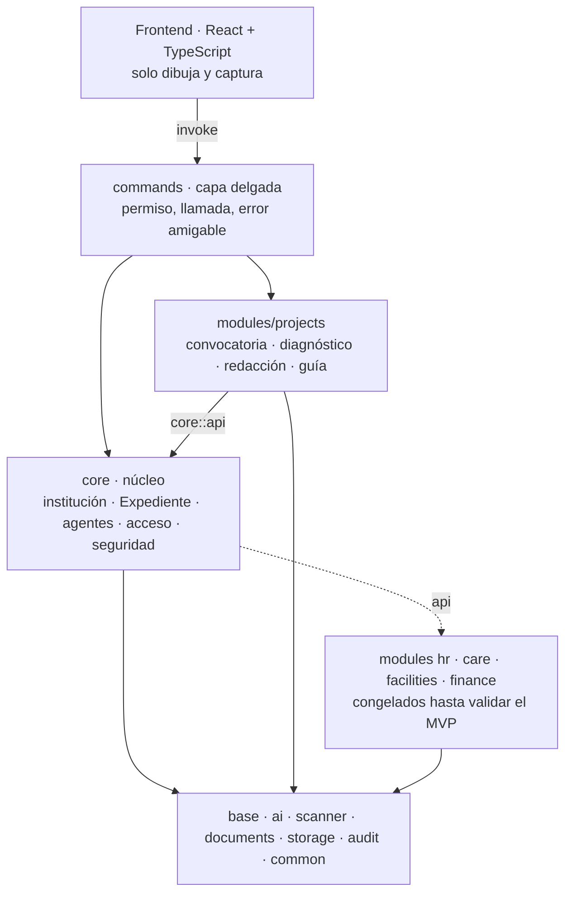

# SociAI (Cimiento)

**Un ERP para organizaciones de la sociedad civil con la IA como núcleo, no como complemento. La persona cuenta y sube sus papeles; el programa ordena, llena, avisa y prepara. Local, cifrado, auditable y con el gasto de IA bajo control.**

> **In English.** SociAI (codename *Cimiento*) is a local-first desktop ERP for small nonprofits and civil-society organizations (Tauri 2 + Rust + React/TypeScript, encrypted SQLite), built with **AI at its core instead of bolted on**: people tell the program about their organization and upload their papers, and a small team of agents (an Assistant, a Capturist and a document Reader per drawer) turns that into structured, cited suggestions that a person accepts. The MVP covers two things: **centralizing the organization** (its profile, its document archive with OCR and a single filling policy, an assistant everywhere) and **grant projects**, from an unstructured grant call to a project that fits it. The AI decides inside a "house" with four limits enforced by code: personal values never leave the machine, nothing is saved without a person, the AI never calculates, and every agent and field has explicit permissions. Every claim is checked by code (quotes must exist in the source, figures must exist in the quote), every agent is validated against the cheapest model, and every decision is backed by a small measurement documented in 43 ADRs. 767 Rust + 211 frontend tests, all green. Being validated with two real charities. UI and docs are in Spanish. Source-available for evaluation, not open source (see [License](#licencia)).

    

## De dónde sale la idea

Las organizaciones de la sociedad civil, sobre todo las de asistencia social, trabajan con poco personal, sin perfil técnico y con la información dispersa:

- **Sus datos viven en carpetas, correos y cabezas.** Actas, poderes, constancias e informes no están en un solo lugar, y cada trámite empieza de cero.
- **Los ERP de siempre no les sirven.** Son caros, técnicos y suponen a alguien que capture todo con paciencia.
- **Pierden tiempo y donativos en los proyectos.** Ponen semanas en proyectos que no caben en la convocatoria o que ni ellas entienden, y piden «remodelar un baño» cuando el donante financia «reducir el riesgo de caídas de las personas mayores».

SociAI nació como una herramienta para ese último problema y creció hacia lo que las propias instituciones pidieron: digitalizar su institución completa. Su apuesta es que en este sector un ERP solo funciona si **la IA quita la fricción** en lugar de agregar pantallas.

## El MVP

El MVP es lo que se valida primero, con dos instituciones reales ([ADR-043](docs/adr/ADR-043-un-erp-con-la-ia-en-el-nucleo.md)).

1. **Centralizar y digitalizar la institución (el núcleo).**
   - **«Mi institución»:** sus datos en formularios descritos como datos en Rust, con el origen de cada dato y un historial ligero.
   - **El Expediente:** sus documentos con vigencia. Lee PDF, Word, Excel, escaneos y fotos, y llena sus datos solo o los deja como sugerencia.
   - **El Asistente:** está en toda la app. Contesta, lleva a cada lugar y convierte lo que la persona cuenta en sugerencias.
   - **Inicio:** dice qué falta y qué vence.
   - **Cuentas, permisos, respaldo cifrado y bitácora.**
2. **Los proyectos.** De una convocatoria (PDF, Word y Excel sin estructura) a un proyecto que cabe en ella y que la institución entiende: la lectura de la convocatoria, una conversación que lleva a la causa de fondo, la redacción y una guía en Word.

**Después del MVP:** Personal, Beneficiarios, Instalaciones, Finanzas y Donantes. Parte de su código ya existe y está oculto hasta validar el MVP.

## La IA decide dentro de la casa

La arquitectura es la casa de la IA, no un vigilante aparte. En lugar de un glosario de reglas que crece con cada caso, el código pone **cuatro límites**:

| Límite | Qué significa |
|---|---|
| **El valor de un dato personal no sale del equipo** | Todo texto pasa por un escáner de datos sensibles antes de guardarse y antes de ir a un modelo. Las fichas de personas nunca van a la IA: solo conteos |
| **Nada se guarda sin una persona** | La IA propone; la persona pulsa «Usar» y «Guardar»; el código guarda con el origen del dato |
| **La IA no calcula** | Totales, presupuestos y validaciones son del código. Una cifra que escribe la IA debe estar en las palabras que cita |
| **Permisos, no reglas de lenguaje** | Cada agente tiene sus herramientas de solo lectura, cada campo dice qué clase de dato acepta y cada comando revisa el permiso de quien lo usa |

Dentro de esos límites, la IA decide qué es cada cosa, a qué campo va, qué documento es y qué preguntar. El código revisa lo que se puede revisar sin adivinar: que una cita esté en su texto (perdonando un desliz de copia, nunca una cifra), que una cifra esté en su cita y que un valor quepa en su campo.

**Los agentes del núcleo** ([ADR-034](docs/adr/ADR-034-ia-en-todo-el-erp-agentes-herramientas-y-conocimiento.md), [ADR-036](docs/adr/ADR-036-cajones-de-documentos-y-un-agente-por-cajon.md)) corren en un bucle propio en Rust, cada uno con su oficio versionado, sus herramientas y sus topes:

| Agente | Qué hace | Medición con el modelo más barato (dos rondas) |
|---|---|---|
| **Asistente** | Contesta desde cualquier pantalla; le pregunta al Lector del cajón y solo cita lo que el Lector le entregó | 33 de 34 bien, nada inventado, ≈ $0.04 MXN por pregunta |
| **Capturista** | «Llenarlo por mí»: lo que la persona cuenta, como sugerencias en la ventana a la que pertenece cada dato | 33 de 34 bien, nada inventado |
| **Lector del Expediente** | Llena «Mi institución» buscando en los documentos campo por campo, con documento y página | 18 de 18 bien, nada inventado, $0.17 MXN por 13 documentos |

Cada agente se valida con el modelo más barato: si funciona con él, funciona con todos. Un modelo más fuerte mejora lo que sugiere, nunca cambia lo que sale del equipo ni lo que se guarda.

## Leer los papeles de una institución

- **Un solo motor de PDF:** Pdfium saca el texto, los párrafos, el guion de corte y las tablas con y sin bordes ([ADR-037](docs/adr/ADR-037-pdfium-unico-motor-de-pdf.md)).
- **Escaneos y fotos con OCR:** Tesseract, con la letra chica agrandada, las hojas giradas enderezadas y un aviso en las páginas dudosas ([ADR-035](docs/adr/ADR-035-leer-paginas-escaneadas-y-fotos-ocr.md)).
- **El tipo de documento se reconoce por sus palabras.** Un archivo solo se guarda en su lugar si el código confía en que es de ahí; si no, pregunta antes de guardar nada ([ADR-042](docs/adr/ADR-042-primer-inicio-solo-lo-indispensable.md)). Medido en seco: de 563 lugares equivocados, ninguno se guardó.
- **Una sola política de llenado** ([ADR-038](docs/adr/ADR-038-politica-unica-de-llenado-desde-documentos.md)):
  - los datos propios del documento (emisión, vigencia, número) se escriben solos;
  - los demás llegan como sugerencia, solo en campos vacíos;
  - nunca se toca lo que escribió la persona, y lo que rechazó no vuelve.
- **Lectura en segundo plano,** con aviso al terminar. El original nunca se modifica; se guarda solo el texto limpio.

## Las convocatorias: un contrato para cualquier donante

La pieza central de los proyectos es [`schemas/canonical_call.schema.json`](schemas/canonical_call.schema.json) (JSON Schema 2020-12): **un contrato universal que fija qué información hace falta de toda convocatoria, sin decir dónde ni cómo está escrita**. El modelo la busca y la rellena con citas, y el código verifica y normaliza ([ADR-015](docs/adr/ADR-015-schema-canonico-de-convocatorias.md)).

1. **Cada dato es su cita.** Cita literal, página y documento; el código comprueba que exista.
2. **`no_aparece` y `ambiguo` son respuestas válidas.** Un campo vacío siempre dice por qué.
3. **El modelo señala, el código normaliza.** Fechas, montos, porcentajes y duraciones los convierte el código desde la cita.
4. **Un paquete, no un PDF.** Si los documentos se contradicen, se guardan todas las versiones y el código no elige.
5. **Agnóstico por diseño.** Ninguna descripción de campo nombra una institución, un formato ni las palabras de un donante.

| Intento | Resultado | Decisión |
|---|---|---|
| **Riel de reglas** (el código segmenta, el modelo etiqueta) | 25/42 y 3/22 hechos verificados a mano; las reglas escritas para un donante descartaban el 48 % de otro | No generaliza |
| **Lectura completa** con modelo fuerte | 34/42 y 11/22, a mayor costo | Mejor, pero cara |
| **Esquema canónico con citas verificadas** (actual) | Tres convocatorias nuevas, **a ciegas**: 96–99 % de citas verificadas, $1.3 a $2.2 MXN por convocatoria | Adoptado; el riel se archivó |

**El diagnóstico no es un chat abierto** ([ADR-017](docs/adr/ADR-017-conversacion-guiada-con-ia.md)):
- empieza por *idea → obstrucción → beneficio futuro*;
- sigue con hasta cinco «¿por qué?», porque lo que se pide casi nunca es el problema, sino su consecuencia;
- el código conduce y garantiza el final: la causa propuesta debe estar citada en las palabras de la persona y el cierre exige su confirmación.

En el ensayo con una convocatoria real, la causa de fondo apareció en la tercera vuelta: el mantenimiento era solo reactivo, no «arreglar el comedor».

## Control de gasto

| Riesgo | Control |
|---|---|
| Chat sin fin | Conversaciones con estructura y topes de pasos por agente; el código fuerza el cierre |
| Clics repetidos | Un proceso de IA por proyecto y una lectura por documento a la vez, desde Rust |
| Saturación del servicio | Cadena de modelos de respaldo ([ADR-008](docs/adr/ADR-008-cadena-de-respaldo.md)); los 5xx no cuentan contra el cupo |
| Límites del proveedor | Ritmo por modelo (por minuto y por día): el programa espera en lugar de provocar un 429; las baterías nunca pasan de 14 solicitudes por minuto |
| Gasto mensual | Tope configurable con aviso al 80 % y pausa de la IA al 100 %; lo que no es IA sigue funcionando |
| Falta de visibilidad | Cada intento, también los fallidos, queda con latencia, tokens, motivo y costo en `ai_usage`; la pantalla «Ayuda automática» lo muestra |

**Probar en seco antes de gastar.** Las pruebas corren contra un servicio de IA simulado. Las pruebas con IA real son opt-in, llevan tope de llamadas y sus resultados se anotan en el roadmap.

## Ética y privacidad por diseño

- **Local primero.** Todo vive en la computadora de la institución, en SQLite **cifrado con SQLCipher**. La llave está en el llavero del sistema operativo y la llave de API nunca llega al frontend.
- **Cuántos, nunca quiénes.** A la IA llegan agregados y lo que la persona escribe, siempre después del escáner. Las fichas de personas no salen del equipo.
- **Escáner de datos sensibles:** CURP, RFC, clave de elector, CLABE, tarjetas, NSS, teléfonos, correos, nombres y contexto de salud, con dígitos verificadores y pruebas positivas y negativas por patrón.
- **Siguiente paso: la bóveda.** Hoy el escáner tapa o le pregunta a la persona. En el plan del MVP, hacia la IA irán marcas tipadas (`[CORREO_1]`, `[NOMBRE_1]`) y nunca el valor. La IA decidirá qué es cada marca por su contexto y el código la resolverá en el equipo, sin detener a la persona.
- **La bitácora no guarda contenido,** solo el tipo de evento y conteos.
- **Términos del proveedor según el uso.** El desarrollo, con datos ficticios, usa el nivel gratuito del proveedor, cuyas condiciones permiten usar el contenido para mejorar sus productos. El uso con documentos reales va con una **API de pago**, bajo términos que no entrenan con el contenido ([ADR-040](docs/adr/ADR-040-nombres-propios-de-la-institucion-en-su-expediente.md)).
- **Lo pendiente:** antes de una entrega general faltan la revisión legal de privacidad (menores y datos de salud) y el aviso de privacidad con su consentimiento.

## UX para quien no es técnico

- **Contar en lugar de capturar.** «Llenarlo por mí» y el Lector dejan sugerencias con su fuente («Usted dijo: …», «Acta constitutiva, página 3»); la persona las usa o las descarta.
- **Dos capas** ([ADR-024](docs/adr/ADR-024-dos-capas-ia-y-persona.md)): lo que consume la IA no es lo que ve la persona. Ella ve una ficha corta en sus palabras.
- **Lo que dice el programa lo escribe el programa.** Lo que quedó sugerido y lo que falta lo compone el código, nunca la IA, que podría prometer lo que el código descartó.
- **Cuando la IA falla, no se inventa nada:** el Asistente responde con el manual sin conexión, y lo que no es IA sigue funcionando.
- **Lenguaje sencillo** con una guía de estilo ([`docs/08-estilo-redaccion.md`](docs/08-estilo-redaccion.md)) y una prueba automática de jerga.

## Arquitectura

Monolito modular ([ADR-032](docs/adr/ADR-032-monolito-modular-nucleo-y-modulos.md)): un núcleo y módulos que solo hablan por su `api`, en capas que solo miran hacia abajo. `cargo test architecture` lo revisa, y también que solo el dueño de una tabla escriba SQL sobre ella.



**Stack:** Tauri 2 · Rust · React 19 · TypeScript · Vite · Tailwind CSS 4 · SQLite + SQLCipher · FTS5 · sqlite-vec · Pdfium · Tesseract · TanStack Query · Vitest · pnpm. Unas 54,000 líneas de Rust, 24,000 de TypeScript y 33 migraciones. La IA va detrás de un trait `AiProvider` (Gemini como principal, Anthropic implementado).

## Validación con instituciones

Dos instituciones de asistencia privada probaron una primera versión con información real suya y con siete convocatorias de la **JAP** y la **JAPEM**. Es retroalimentación cualitativa, reportada por el autor ([`docs/12-validacion-con-instituciones.md`](docs/12-validacion-con-instituciones.md)):

- **Menos carga de trabajo** al armar proyectos. Es una percepción: no se midieron tiempos.
- **Un proceso sencillo** que no imaginaban: una herramienta que las acompaña a pensar sus proyectos.
- **Pidieron más:** digitalizar sus procesos, empezando por su institución, sus empleados y sus beneficiarios. De ahí salió el giro hacia un ERP.

El núcleo se probó después con una institución inventada y 24 archivos con fallas a propósito (escaneos, fotos, una hoja girada, una copia desteñida, un archivo con contraseña): 33 de 39 datos quedaron bien a la primera, y de lo que falló salió el [ADR-042](docs/adr/ADR-042-primer-inicio-solo-lo-indispensable.md) ([`docs/16-institucion-de-prueba.md`](docs/16-institucion-de-prueba.md)).

## Estado

**MVP en construcción.** El núcleo está hecho y en prueba; los proyectos ya existen de la primera versión y se revisan sobre la base nueva.

| Bloque | Estado |
|---|---|
| Núcleo: «Mi institución», Expediente, Lector, Asistente, Capturista, política de llenado | Hecho; en prueba con el guion del núcleo |
| MVP-1 · Ocultar los módulos congelados | Siguiente |
| MVP-2 · La bóveda: marcas hacia la IA en lugar de valores | Pendiente |
| MVP-3 · El núcleo genérico para cualquier organización civil | Pendiente |
| MVP-4 · Proyectos sobre la base nueva, validados con las dos instituciones | Pendiente |

Roadmap completo en [`docs/09-roadmap.md`](docs/09-roadmap.md) (Fase 11) y estado del día en [`docs/00-mapa-del-proyecto.md`](docs/00-mapa-del-proyecto.md).

### Limitaciones conocidas

- **Muestras pequeñas.** Las mediciones usan pocas convocatorias, documentos ficticios y corridas cortas: sirven para decidir, no para afirmar rendimiento general.
- **El núcleo todavía supone un asilo o una casa hogar I.A.P.** en varias opciones y textos. Volverlo genérico es el bloque MVP-3.
- **El escáner se equivoca con nombres de lugares** que son nombres de personas («alcaldía Benito Juárez») y entonces le pregunta a la persona. La bóveda (MVP-2) lo resuelve de raíz.
- **El OCR no lee letra a mano,** y una copia poco clara se lee con errores (se avisa qué páginas). Word y Excel se leen, no se llenan.
- Solo Windows por ahora.

## Cómo correrlo

Requisitos: Node.js (LTS), pnpm, Rust estable y WebView2 (ya viene con Windows 11). En **Windows**, SQLCipher compila OpenSSL desde fuente y necesita [Strawberry Perl](https://strawberryperl.com/) **antes** que el `perl` de Git en el `PATH`; la primera compilación tarda unos 11 minutos ([ADR-002](docs/adr/ADR-002-sqlite-sqlcipher.md)).

```bash
pnpm install
powershell -ExecutionPolicy Bypass -File scripts/fetch-ocr.ps1   # una vez: Tesseract y Pdfium (no viven en el repositorio)
pnpm tauri dev                 # app en desarrollo
pnpm test                      # 211 pruebas del frontend (Vitest)
cd src-tauri && cargo test     # 767 pruebas de Rust: sin red ni costo, con IA simulada
pnpm tauri build --bundles nsis   # instalador de Windows
```

Para usar la IA real hace falta una llave de API de Gemini, que se captura dentro de la app («Ayuda automática») y se guarda en el llavero del sistema. Sin llave, la app guarda todo, y el Asistente responde con el manual. Las pruebas con IA real están en [`docs/agents/comandos-y-pruebas.md`](docs/agents/comandos-y-pruebas.md).

## Documentación

| Documento | Contenido |
|---|---|
| [`docs/00-vision.md`](docs/00-vision.md) | Qué es, el MVP y para quién |
| [`docs/00-mapa-del-proyecto.md`](docs/00-mapa-del-proyecto.md) | Dónde estamos, qué sigue y qué espera respuesta |
| [`docs/01-arquitectura.md`](docs/01-arquitectura.md) | Stack, capas y flujos |
| [`docs/03-gobernanza-datos.md`](docs/03-gobernanza-datos.md) | Niveles de datos, reglas, borrado, bitácora |
| [`docs/04-escaner-datos-sensibles.md`](docs/04-escaner-datos-sensibles.md) | Detección de datos personales |
| [`docs/05-modelo-datos.md`](docs/05-modelo-datos.md) | Esquema de la base de datos |
| [`docs/07-ia-y-costos.md`](docs/07-ia-y-costos.md) | Reparto código/IA, modelos, mediciones y control de gasto |
| [`docs/08-estilo-redaccion.md`](docs/08-estilo-redaccion.md) | Cómo le habla la app a la persona |
| [`docs/09-roadmap.md`](docs/09-roadmap.md) | Fases, criterios de terminado y avance |
| [`docs/10-metodologia-conversacion.md`](docs/10-metodologia-conversacion.md) | Método del diagnóstico conversacional |
| [`docs/13-sistema-visual.md`](docs/13-sistema-visual.md) | Sistema visual y componentes |
| [`docs/15-guion-pruebas-nucleo.md`](docs/15-guion-pruebas-nucleo.md) | Guion de pruebas del núcleo, pantalla por pantalla |
| [`docs/agents/`](docs/agents/) | Guía para los agentes de desarrollo: principios, glosario, comandos, flujo y metodología de los Lectores |
| [`docs/adr/`](docs/adr/) | 43 decisiones de arquitectura con contexto, mediciones y consecuencias |
| [`schemas/`](schemas/) | Esquema canónico de convocatorias (JSON Schema) |
| [`fixtures/`](fixtures/) | Datos **ficticios** para desarrollo y pruebas |

**Por dónde empezar a leer:**
- [ADR-043](docs/adr/ADR-043-un-erp-con-la-ia-en-el-nucleo.md): el ERP con la IA en el núcleo;
- [ADR-036](docs/adr/ADR-036-cajones-de-documentos-y-un-agente-por-cajon.md): un agente por cajón de documentos;
- [ADR-038](docs/adr/ADR-038-politica-unica-de-llenado-desde-documentos.md): una sola política de llenado;
- [ADR-015](docs/adr/ADR-015-schema-canonico-de-convocatorias.md): de las reglas al contrato con citas verificadas;
- [ADR-003](docs/adr/ADR-003-ia-propone-codigo-escribe.md): la IA propone, una persona acepta.

## Método de trabajo

Proyecto individual, dirigido por especificación. `docs/` es la fuente de verdad, cada decisión y cada medición quedan en un ADR, y las reglas de trabajo viven en [`docs/agents/`](docs/agents/). El desarrollo se apoya en agentes de código bajo el mismo principio que el producto: **la IA propone, y las pruebas, los ADR y el criterio del autor deciden**. El problema, el alcance, el análisis y la validación con las instituciones son del autor.

## Datos y privacidad del repositorio

**Ningún dato real de personas o instituciones está en este repositorio.** Todo lo de `fixtures/` es inventado: las CURP, CLABE y NSS de prueba tienen formato válido pero no pertenecen a nadie. Las convocatorias y los documentos reales con los que se midió no se incluyen; los documentos solo citan resultados de su lectura.

## Licencia

Código visible para consulta y evaluación; **todos los derechos reservados**. No se concede permiso para copiarlo, modificarlo ni usarlo sin autorización por escrito. Ver [`LICENSE`](LICENSE).

## Autor

Jaime Alberto Caballero Ponce · Ingeniería y análisis de datos · [GitHub](https://github.com/) · [LinkedIn](https://www.linkedin.com/)
