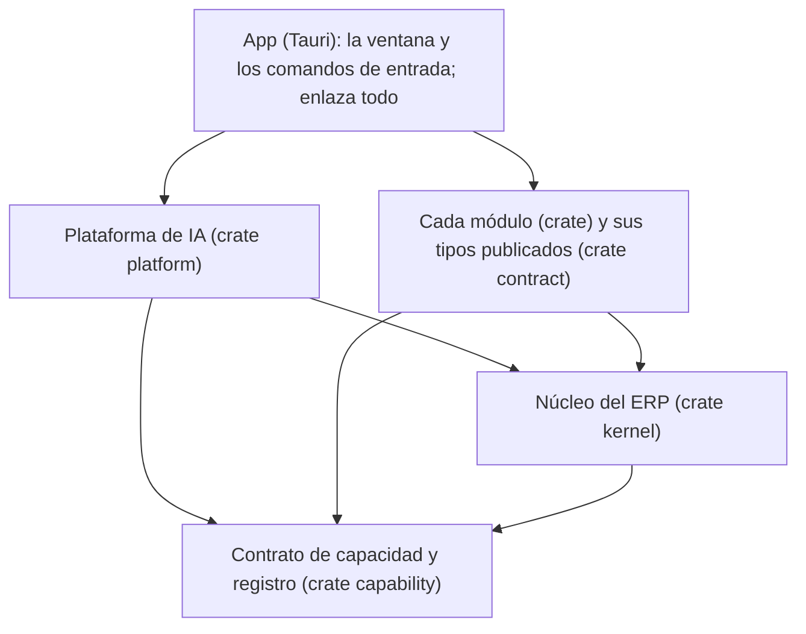
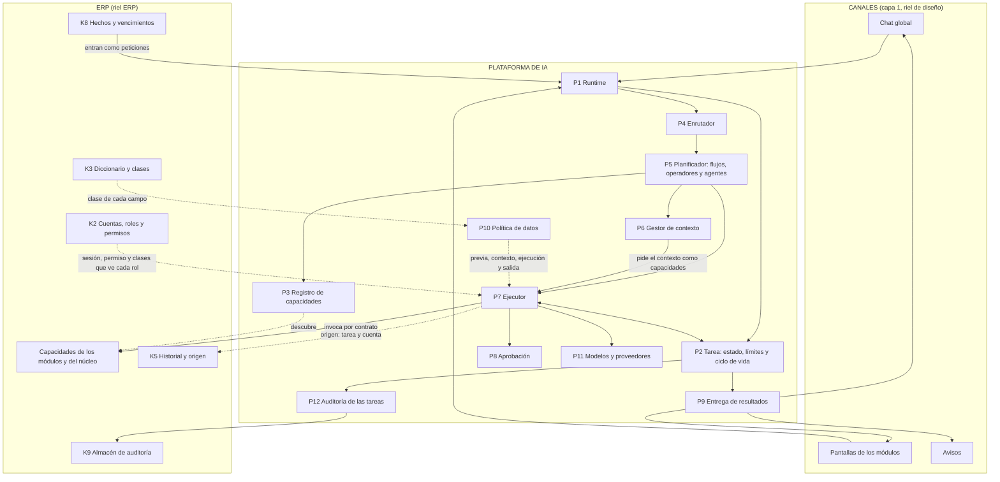
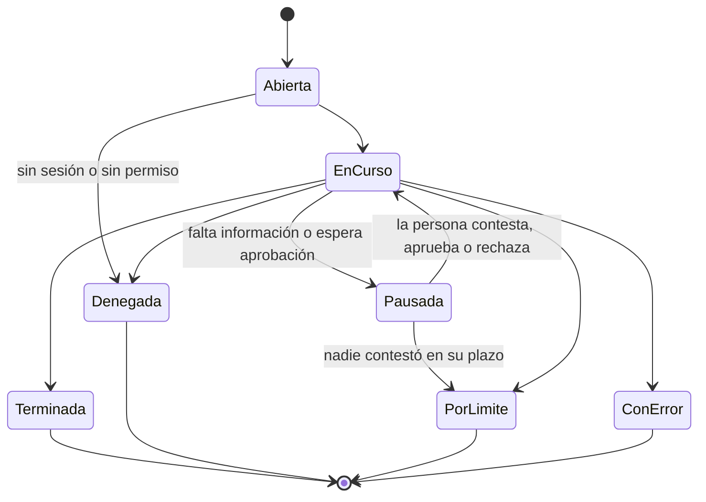

# Plano de la IA

**Aprobado por el líder el 2026-10-21, con las siete decisiones de la §12** (bloque IA-6, [ADR-003](adr/ADR-003-la-plataforma-de-ia-por-dentro.md)). Detalla, para el riel IA, las cajas que le tocan en [los planos de SociAI](planos-de-sociai.md):
- la capa 3 completa: la plataforma de inteligencia;
- de la capa 4, los operadores, los agentes y las herramientas de IA;
- de la capa 6, lo que es suyo: la clasificación aplicada, la política de datos, la validación de los contratos, la confirmación y la auditoría de las tareas.

No cambia los planos: los aterriza. Si algo de aquí choca con ellos, mandan los planos. Si este plano cambia, se cambia aquí primero, con su fila en la §13.

**Es la pareja del [plano del ERP](plano-del-erp.md).** Se leen juntos:
- la §7 dice, punto por punto, dónde se tocan los dos y quién define cada cosa;
- la §8 dice lo que este plano le pide al ERP para que los dos cuadren.

**Cómo se hizo.** Igual que el plano del ERP: primero los planos, el plano del ERP, los ADR-001 y ADR-002 y la [investigación](investigacion/README.md). El código se consultó solo al final, para el veredicto de la §10. Nada se diseña para acomodar lo que ya existe.

---

## 1. La respuesta corta

1. **Una sola puerta.** Toda petición entra al runtime:
   - lo que se escribe en el chat;
   - lo que pide una pantalla, también guardar un formulario (D6 del ERP);
   - los hechos y los vencimientos del calendario.

   No hay otra forma de invocar una capacidad.
2. **La tarea es la unidad.** Cada petición abre una tarea o reanuda una que ya existe. La tarea:
   - lleva su id, su estado y sus límites;
   - se guarda en la base;
   - siempre se cierra con registro.

   Una pausa o una aprobación pendiente sobreviven a cerrar la app.
3. **Un solo ejecutor.** Es lo único que invoca una capacidad y lo único que llama a un modelo. Antes y después de cada invocación aplica los mismos controles: límites, permisos, política de datos y validación. Ningún agente puede saltárselos, porque no tiene otro camino.
4. **El modelo, solo donde hay ambigüedad.** Hay tres niveles: el flujo determinista (sin modelo), el operador (una interpretación puntual) y el agente (varios pasos). Se usa el más simple que sirve. Una pantalla que pide una capacidad concreta nunca pasa por un modelo.
5. **El control son datos, no *prompts*.** Qué ve el modelo sale de tres cosas:
   - la clase de cada dato, que el ERP declara en su diccionario;
   - el rol de la persona (K2);
   - el proveedor.

   Se decide en el plano de control, en cuatro puntos fijos (§9), y se prueba sin modelo.
6. **El ERP no sabe que la IA existe.** La plataforma usa del ERP solo sus capacidades y unas pocas interfaces del núcleo (§7). Ni el núcleo ni un módulo pueden usar la plataforma: no compila.
7. **Ejecutar no es entregar.** Todo sale por un contrato común de resultados, con el id de la tarea y su destino. El riel de diseño lo dibuja igual en el chat, en las pantallas y en los avisos.

---

## 2. Dónde vive la plataforma: los *crates*

El ERP-8 arma un *workspace* de Cargo para que el compilador haga cumplir las fronteras del ERP (D5). La plataforma entra al mismo *workspace* con la misma regla.



### Reglas de dependencia

1. **El contrato es lo más bajo.** No depende del ERP ni de la plataforma. Así lo pueden usar el núcleo, los módulos y la plataforma (§12, A2).
2. **La plataforma depende del contrato y del núcleo, nunca de un módulo.** A los módulos los conoce solo por el registro, cuando el programa corre.
3. **Ni el núcleo ni un módulo dependen de la plataforma.** Es la regla del IA-1. Ahora la hace cumplir el compilador, y no una prueba que lee el texto.
4. **La plataforma no conoce Tauri.** La app le pasa los canales de entrega (§6), así que la plataforma se prueba completa sin ventana.
5. **Solo la app enlaza todo.** Nombra cada *crate* de módulo una vez, para que el registro de capacidades y el de módulos lo vean. Es el riesgo de `linkme` que ya anotó el ERP-8.

**Mientras el ERP-8 no entre a `main`,** lo nuevo de la plataforma se escribe en la app sin depender de su código viejo. Así, pasarlo a su *crate* es mover archivos.

---

## 3. Las piezas de la plataforma



La política (P10) vigila cuatro puntos: antes del enrutador, al armar el contexto, en el ejecutor y en la entrega (§9). En el diagrama se dibuja una sola flecha para no enredarlo.

| | Pieza | Caja de los planos | Qué hace | Qué usa del ERP |
|---|---|---|---|---|
| **P1** | Runtime | Runtime de ejecución | <ul><li>Recibe toda petición.</li><li>Toma la identidad y la organización de la sesión, nunca de lo que manda la pantalla.</li><li>Abre la tarea o reanuda la que ya existe.</li></ul>Una pantalla que nombra una capacidad va directo al planificador como flujo determinista. Un texto pasa antes por la política previa y el enrutador. | K1, la organización. K2, la sesión. |
| **P2** | Tarea | Estado, límites y ciclo de vida | El estado (§5), los límites de su tipo de tarea, la cuenta de pasos, reintentos, gasto y tiempo, y la detección de ciclos. Se guarda en la base. | K4: sus propias tablas (`ai_`), con el mecanismo de migraciones por dueño. |
| **P3** | Registro | Registro común de capacidades | El del ADR-001: descubre los contratos al enlazar y los revisa. Lista también los operadores y agentes de la plataforma (`ia.…`). Filtra solo por módulo y por efecto; el permiso lo revisa el ejecutor. | K12: qué módulos están encendidos. Una capacidad de un módulo apagado no se ofrece. |
| **P4** | Enrutador | Enrutador de tareas | Con el texto que la política dejó pasar, entiende la intención y propone capacidades. Elige solo **de una lista ya filtrada** por módulo encendido, permiso de la persona y lugar, y con pocas opciones por intención, nunca la lista completa. No autoriza nada ni lee datos del negocio. | — |
| **P5** | Planificador | Planificador de flujos | Decide el nivel de ejecución (§4) y arma los pasos. Los flujos deterministas son código de la plataforma que combina capacidades: las vistas de varios módulos, como Inicio, y las reacciones a los hechos. | — |
| **P6** | Gestor de contexto | Gestor de contexto | Arma el contexto mínimo para un operador o un agente. Lo pide **como capacidades, por el ejecutor**, nunca leyendo tablas, y lo filtra con la política. Prefiere referencias y traer las cosas justo cuando hacen falta. | Las capacidades de lectura de los módulos y del núcleo: el perfil, los documentos con su página, la búsqueda y el historial. |
| **P7** | Ejecutor | Ejecutor de capacidades; validación de contratos | Lo único que invoca capacidades y modelos.<ul><li>**Antes:** la tarea sigue activa y dentro de sus límites; el permiso; la entrada cabe en su esquema; la política.</li><li>**Después:** la salida cabe en su esquema; la política; el registro del paso.</li><li>**En un cambio:** prepara, pide la aprobación si toca y aplica con la huella.</li></ul> | K2 autoriza. K3 da las clases. K5 recibe el origen. |
| **P8** | Aprobación | Confirmaciones humanas | Guarda la propuesta pendiente, atada a su huella. Solo una acción de la persona, con su sesión, la aprueba; la decisión de un agente nunca cuenta. Si la huella cambia, se pide otra vez. | La propuesta y la huella del ERP-9. |
| **P9** | Entrega | Entrega de resultados | El contrato común de resultados (§6) y sus canales. Antes de entregar revisa otra vez el permiso y la política de salida. Lo que llega después se consulta por el id de la tarea o se avisa. | — |
| **P10** | Política de datos | Clasificación de datos; políticas de datos y PII | Una sola decisión: dado un dato con su clase, un destino y una finalidad, dice si va, si va tapado, si va solo como agregado o si no va. Se aplica en cuatro puntos (§9). Incluye el detector local (hoy, el escáner) y la bóveda de marcas. Las clases y su tabla las fija el ADR del IA-3. | K3, la clase de cada campo. K2, qué clases ve cada rol. |
| **P11** | Modelos y proveedores | Operadores de IA (capa 4) | Los proveedores intercambiables, el modelo de cada nivel, los precios, el ritmo y el tope de gasto. Cada proveedor declara su nivel (pagado o gratuito) y sus condiciones, y la política los usa. Solo el ejecutor lo llama. | — |
| **P12** | Auditoría de las tareas | Auditoría y trazabilidad | Escribe en el almacén del núcleo la apertura, cada paso, cada denegación, cada aprobación y el cierre, con el id de la tarea y sin datos personales. También el uso de los modelos (hoy `ai_usage`). | K9. |

### Un recorrido completo: un cambio pedido en el chat

Es el lado de la plataforma del recorrido de la §7 del plano del ERP.

```mermaid
sequenceDiagram
    participant U as Persona (chat)
    participant R as Runtime
    participant P as Política
    participant E as Enrutador
    participant T as Tarea
    participant X as Ejecutor
    participant M as Capacidad del módulo
    participant D as Entrega
    U->>R: «El teléfono de la institución ahora es 55 1234 5678»
    R->>R: sesión y organización (K1, K2)
    R->>P: ¿qué del texto puede ir al modelo?
    P-->>R: el texto, tapado si hace falta
    R->>E: intención, con las capacidades ya filtradas por permiso
    E-->>R: mi_institucion.actualizar_contacto y su entrada
    R->>T: abrir la tarea: objetivo, límites e id
    T->>X: paso 1
    X->>X: límites, permiso, esquema de la entrada y política
    X->>M: prepare(entrada)
    M-->>X: propuesta: diferencias, validación, versión base y huella
    X->>T: en pausa, esperando aprobación
    T->>D: Propuesta, con el id de la tarea
    D-->>U: qué cambia y de dónde sale el valor
    U->>R: aprobar (tarea y huella)
    R->>T: reanudar la misma tarea
    T->>X: paso 2
    X->>X: permiso otra vez; ¿la huella sigue igual?
    X->>M: apply(entrada, huella)
    M-->>X: aplicado: dato, historial con la tarea y hecho, en una transacción
    X->>T: paso registrado
    T->>D: Respuesta con su evidencia; cierre «terminada»
    D-->>U: «Listo. Lo tomé de lo que usted escribió.»
```

---

## 4. Los tres niveles de ejecución

| Nivel | Cuándo | Modelo | Ejemplo |
|---|---|---|---|
| **Flujo determinista** | La operación es conocida: la nombra una pantalla, la dispara un hecho, o la intención ya resuelta tiene un solo camino | Ninguno | Guardar el perfil; «¿qué me falta?» desde Inicio; preparar la póliza cuando se registra un donativo |
| **Operador** | Hay que interpretar algo puntual: un texto, un documento, una redacción | Una llamada, con el esquema de su respuesta | Proponer valores a partir de un acta; redactar una sección |
| **Agente** | Un objetivo de varios pasos que no se puede escribir de antemano | Un ciclo, con los límites de la tarea | «Prepárame lo que necesito para esta convocatoria» |

**Las reglas:**
- **El más simple que sirve** ([investigación](investigacion/investigacion-externa.md), §3.1 y §3.4). Lo que se puede escribir como código se escribe como código.
- **Los operadores y los agentes se declaran en la plataforma,** con el mismo contrato que una capacidad: un id `ia.…`, su efecto, sus clases de datos y sus límites. Llevan además su *prompt* versionado, el esquema de su respuesta y su nivel de modelo. Aparecen en el mismo registro y los invoca el mismo ejecutor. Ningún módulo declara un operador (§12, A6).
- **Las herramientas de un agente son capacidades:** las mismas que usa una pantalla, ya filtradas por permiso. El agente pide una, y el ejecutor la corre con todos sus controles.
- **Un agente no aplica un cambio.** Lo prepara, y la aprobación es de la persona.
- **El agente no decide cuándo parar:** lo para la tarea (§5).

---

## 5. La tarea



- **Cada turno se cierra con registro:** terminada, pausada, denegada, por límite o con error, con su motivo y sus ids, como dice el plano operativo. Una tarea pausada se reanuda en la misma tarea.
- **Rechazar una propuesta** cancela esa acción, no la tarea. Queda como un paso, y la tarea sigue o termina.
- **Lo que guarda:**
  - el id, que es el id de correlación de todo lo demás;
  - la organización, la cuenta, el canal de origen y el tipo de tarea;
  - sus pasos, con la capacidad, el resultado y los ids;
  - la conversación.

  Todo va en la base cifrada, como cualquier dato. La auditoría solo lleva ids y motivos.
- **Los límites son del tipo de tarea, no del agente.** Una petición de pantalla tiene un paso y ningún modelo; una del chat, pocos pasos; un agente, más. Los valores van en la configuración de la plataforma:
  - pasos;
  - reintentos por paso;
  - gasto, que se reserva antes de cada llamada al modelo y se ajusta después;
  - tiempo total;
  - plazo de una pausa.
- **Un ciclo sin progreso se corta.** La misma capacidad con la misma entrada dos veces en una tarea la cierra por límite.
- **Un cambio incierto no se repite.** Si un `apply` no contestó (se acabó su tiempo o se cerró la app), el paso queda «incierto». Al reanudar, la plataforma le pregunta al historial (K5) si esa huella se aplicó, y nunca lo repite a ciegas.

---

## 6. La entrega: el contrato común de resultados

### La petición

| Campo | Qué es |
|---|---|
| organización | La de la sesión (K1) |
| cuenta | La de la sesión. La pantalla nunca la manda |
| canal | Chat, pantalla (con su lugar) o evento (con su hecho) |
| tarea | Si reanuda una |
| contenido | Uno de cuatro:<ul><li>un texto de la persona;</li><li>una capacidad con su entrada;</li><li>la respuesta a una aclaración;</li><li>la decisión sobre una propuesta, con su huella.</li></ul> |

### El resultado

Es lo que dibuja el riel de diseño.

| Tipo | Lleva | Canal |
|---|---|---|
| **Respuesta** | El texto y su evidencia: de dónde sale cada dato (documento y página, historial, cálculo, lo que dijo la persona) | Chat |
| **Datos** | La salida de una capacidad, con su esquema | Pantalla |
| **Aclaración** | Qué falta, como campos del diccionario con sus opciones (*elicitation*). El texto libre es opcional | Chat y pantalla |
| **Propuesta** | Qué cambia (antes y después), de dónde sale cada valor, lo que no pasa la validación y su huella. Si se pide otra vez, por qué | Chat y pantalla |
| **Estado** | En curso, en pausa o esperando aprobación, con su avance | Chat, pantalla y aviso |
| **Error** | Qué pasó, en palabras de la persona, y siempre un camino para seguir | Todos |

- **Todos llevan** el id de la tarea, el paso, el destino y la hora.
- **Lo asíncrono:** la pantalla consulta la tarea por su id, o llega un aviso. La persona no tiene que quedarse en la pantalla de origen.
- **La plataforma no conoce Tauri.** La app convierte la entrega en eventos de la ventana.

---

## 7. Dónde se toca con el ERP

Es la tabla para cuadrar los dos planos.
- **Acordado:** ya estaba en un ADR, en el plano del ERP o en una tarjeta.
- **Aprobado y pedido:** lo aprobó el líder con este plano, y lo construye el riel ERP. Los pedidos están juntos en el ERP-10 (§8).

| # | Punto | Lo define | Lo usa | Plano del ERP | Este plano | Estado |
|---|---|---|---|---|---|---|
| 1 | El contrato de capacidad y el registro | IA (ADR-001; su *crate* en el IA-5) | ERP: cada módulo, y el núcleo, publican sus capacidades | §4 `capabilities`; prueba de conformidad | P3; §2 | Acordado (ADR-001). Su *crate*: aprobado (A1, A2) y pedido |
| 2 | Los permisos | ERP: cada módulo los declara en su manifiesto, y K2 los agrupa en roles | IA: el contrato nombra el permiso; el ejecutor le pregunta a K2 | K2 | P7 | Aprobado (A2) y pedido: el contrato nombra el permiso por su id |
| 3 | Qué clases de datos ve cada rol | ERP (K2) | IA: la política, al armar el contexto y al entregar | K2; D2 | P10 | Pedido. Las clases, con el IA-3 |
| 4 | Las clases de datos | IA: cuáles hay y qué permite cada una (ADR del IA-3) | ERP: declara la de cada campo en el diccionario (ERP-2) | K3 | P10 | Acordado (tarjetas ERP-2 e IA-3) |
| 5 | La clase en la salida de una capacidad | ERP: el tipo de salida nombra el campo del diccionario | IA: toma la clase de K3, campo por campo | §4 `catalog` y `contract` | P10 | Aprobado (A5) y pedido, con el ERP-2 |
| 6 | La propuesta y la huella | ERP (ERP-9) | IA: la muestra, ata la aprobación y pasa la huella al aplicar | §7 | P8 | Acordado en el IA-2: el formato, antes de cerrar el ERP-9 |
| 7 | La llamada (`Call`) | IA | ERP la lee: la cuenta, la organización, la tarea y la huella aprobada | §7 (origen) | P7 | Lo hace el riel IA: le agrega la organización y la huella. El formato de la huella, con el ERP-9 |
| 8 | El origen y el historial | ERP (K5) | IA: da la tarea y la cuenta en la llamada, pide la evidencia por capacidad y pregunta si una huella se aplicó | K5 | P2; P7 | Pedido: consultar por huella |
| 9 | «Qué falta» y preguntarle a la persona | ERP: lo calcula el núcleo (K3) | IA: `NeedsPerson` nombra campos del diccionario, y la entrega los manda como aclaración con opciones | §8 | P9 | Pedido por el ERP, para cuando exista el ERP-2 |
| 10 | Hechos y vencimientos | ERP (K8): los emite, y cada módulo declara a qué reacciona | IA: entran al runtime como peticiones, y las reacciones corren como flujos por el ejecutor | K8; §4 `events` | P1; P5 | Aprobado (A7) y pedido, con el ERP-3 |
| 11 | Las vistas de varios módulos | IA: un flujo que combina capacidades (P5) | ERP: publica las capacidades de cada parte | §2; §6.3 | P5 | Acordado (lo dice el plano del ERP) |
| 12 | La auditoría | ERP: el almacén (K9) | IA: escribe los eventos de sus tareas | K9 | P12 | Pedido: el evento de tarea |
| 13 | Las tablas de la plataforma | IA: tareas, pasos, aprobaciones y uso de los modelos | ERP: el mecanismo de migraciones por dueño (K4) | K4 | P2 | Aprobado (A3) y pedido: la plataforma es un dueño más |
| 14 | Documentos y búsqueda | ERP (K6 y K10) | IA: el conocimiento documental del gestor de contexto, por capacidades del núcleo | K6; K10 | P6 | Aprobado (A2) y pedido: el núcleo publica capacidades |
| 15 | Los comandos de Tauri | ERP retira los de cada módulo (D6) | IA da la entrada al runtime; diseño la llama | D6 | P1 | Acordado (D6) |

**Lo que el ERP le pidió al riel IA, y dónde queda:**
- **IA-5:** que un módulo, siendo un *crate* aparte, declare sus capacidades con los permisos que él mismo define. Lo resuelven la §2 y la decisión A2.
- **Con el ERP-2:** que «falta información de la persona» nombre campos del diccionario. Es el punto 9 y la aclaración de la §6.
- **Con el segundo módulo:** que un flujo determinista invoque capacidades de otro módulo por el ejecutor. Es el planificador (P5) y el punto 11.

---

## 8. Lo que este plano le pide al ERP

Los aprobó el líder con el plano (2026-10-21). Están juntos en el pedido **ERP-10**, y el riel ERP decide en qué bloque suyo entra cada uno. El 1 va primero, porque toca al ERP-8, que está en curso.

1. **El contrato, debajo del núcleo** (A2). Hoy el ERP-8 muda `Permission` al núcleo, y el contrato lo toma de ahí. Se propone al revés:
   - el contrato nombra el permiso por su id (`contabilidad.polizas.registrar`);
   - el catálogo de permisos, los roles y la decisión siguen en K2.

   Así el núcleo también puede publicar capacidades: documentos, búsqueda e historial.
2. **Una pregunta de autorización en K2:** dada la cuenta, la organización y el permiso, sí o no. Y otra: qué clases de datos ve esa cuenta.
3. **La plataforma, dueña de sus tablas** con el mecanismo del K4: prefijo `ai_` y migraciones propias.
4. **Saber en K5 si una huella se aplicó,** para no repetir un cambio incierto.
5. **Un evento de tarea en K9:** apertura, paso, denegación, aprobación y cierre, con el id de la tarea, la capacidad, el resultado y el motivo.
6. **Un actor del sistema en K8,** para las reacciones a hechos y los vencimientos, con permisos mínimos y sin poder aprobar nada (A7).
7. **Que los tipos de salida nombren sus campos del diccionario** (A5), para que la clase de un dato se declare una sola vez.

---

## 9. La política de datos en cuatro puntos

La política es **una sola decisión**, que se puede probar sin modelo: dada la clase de un dato, un destino y una finalidad, dice si va, si va tapado, si va solo como agregado o si no va.

- **Los destinos:**
  - un modelo de un proveedor pagado;
  - un modelo de un proveedor gratuito;
  - la pantalla de la persona;
  - un aviso;
  - la auditoría.
- **Las clases y los valores de la tabla** los fija el ADR del IA-3. El punto de partida es el de la investigación (§4.4):
  - lo público o de la institución, que va, y solo a un proveedor pagado;
  - lo propio protegido (RFC, CLABE, folios), que solo leen las reglas;
  - lo personal de terceros, que nunca va;
  - lo sensible, que nunca va, y a lo más como agregado de 3 o más.

| Punto | Qué revisa | Si no pasa |
|---|---|---|
| **Previa**, antes del enrutador | El texto de la persona. Como no trae clase declarada, el detector local busca datos de personas, y con eso, el proveedor y la finalidad se decide si va tal cual, tapado o no va | Se atiende sin IA, si la pantalla nombró la capacidad; si no, se detiene y se explica |
| **Contexto** | Cada dato que junta el gestor, por la clase de su campo, el rol de la persona y el proveedor. Solo lo que la tarea necesita | El dato no entra. Si entra tapado, la bóveda guarda el valor solo en memoria |
| **Ejecución** | Que la cuenta vea las clases que toca la capacidad, y que la entrada no lleve lo que la capacidad no declara | Se deniega |
| **Salida** | Qué lleva el resultado y a qué canal va. Los valores tapados se restauran solo hacia la persona | Se quita lo que no puede salir |

**Ninguna regla de qué ve la IA se escribe en un *prompt*, en una herramienta ni en una expresión regular de un agente.** El detector local es la segunda capa, detrás de la clase declarada, y se miden tanto sus fallas como sus falsas alarmas.

---

## 10. El código de hoy frente a este plano (riel IA)

Mismos veredictos que [el código frente a los planos](codigo-frente-a-los-planos.md).

| Código | Va a | Veredicto |
|---|---|---|
| `capability/` (contrato, macro y registro) | P3 y el *crate* `capability` | **Refactor:** se muda a su *crate* (IA-5) y nombra el permiso por su id. La forma del contrato no cambia. |
| `ai/settings.rs`, `anthropic.rs`, `gemini.rs`, `paced.rs`, `metrics.rs` | P11 | **Se conservan.** Cada proveedor agrega su nivel (pagado o gratuito) para la política. |
| `ai/pipeline.rs` | La llamada al modelo dentro del ejecutor (P7, P11) | **Refactor:** el tope mensual pasa a ser una reserva de la tarea, y `ai_usage` lleva el id de la tarea. |
| `ai/agent.rs` | El agente (P5) | **Refactor:** sus herramientas pasan a ser capacidades invocadas por el ejecutor, y lo para la tarea. Así se cierra la falla del ciclo sin fin que ya se comprobó. |
| `ai/vault.rs` | P10, la bóveda | **Se conserva.** Se usa solo cuando la política dice «va tapado». |
| `scanner/` | P10, el detector local | **Se conserva** como segunda capa. Deja de decidir la política: sus «frases seguras» salen. |
| `ai/prompts.rs` y las tareas viejas de `AiTask` | P5 | **Se retiran** las tareas de Proyectos. El mecanismo de *prompts* versionados se conserva para los operadores. |
| `ai/figures.rs` | P7, la validación de la salida | **Se conserva:** la IA no inventa cifras. |
| `ai/mock.rs`, `golden.rs`, `dry_run_tests.rs` (apagado) | Las pruebas de la plataforma | **Refactor:** un impulsor propio y una batería por categorías: caso normal, datos incompletos, ambigüedad, seguridad, fuera de alcance y varios turnos. |
| `ai/canonical/` (lectura de convocatorias) | Un operador, cuando haya núcleo | **Detenida**, por decisión del líder. No se elimina. |
| `commands/ai.rs` (configuración de la IA) | Capacidades `ia.…` por el runtime | **Refactor**, con D6. |
| `core/ai_sheet.rs` | P6 | **Se retira** (lo dice también el plano del ERP). |
| `audit/`, `ai_usage` | P12 sobre K9 | **Refactor:** el id de la tarea y el evento de tarea. |
| `architecture_tests.rs` (la frontera de `crate::ai`) | Las reglas de la §2 | **Se conserva** hasta que el compilador la sustituya. |

**Lo que no existe:** el runtime, la tarea, el ejecutor, la aprobación atada a la huella, la entrega, el enrutador, el planificador, el gestor de contexto y la política por clase.

---

## 11. Cómo se construye (bloques del riel IA)

El esqueleto primero, sin modelo, probado con **una** capacidad de punta a punta, igual que el riel ERP.

| Orden | Bloque | Terminado cuando (resumen) |
|---|---|---|
| 1 | **IA-6 · El plano de la IA y su ADR** (este documento) | El líder aprueba el plano y las decisiones de la §12, y el ADR-003 las recoge. |
| 2 | **IA-2 · El esqueleto sin IA** (P1, P2, P7, P8, P9, P12) | <ul><li>Una petición de pantalla recorre runtime → tarea → ejecutor → entrega con una capacidad de muestra.</li><li>Los límites cortan una tarea que no avanza.</li><li>Todo cierre se registra.</li><li>La aprobación va atada a la entrada (y a la huella cuando llegue el ERP-9).</li><li>Las tareas se guardan en la base.</li></ul> |
| 3 | **IA-5 · El contrato y la plataforma como *crates*** (A1, A2), después del ERP-8 | El módulo de muestra declara una capacidad desde su *crate*, con un permiso suyo, y el compilador impide que el núcleo o un módulo usen la plataforma. |
| 4 | **IA-3 · Las clases y la política** (P10) | El ADR de las clases; la política en los cuatro puntos; un proveedor gratuito no recibe datos personales ni confidenciales. |
| 5 | **IA-4 · El enrutador, el primer operador y el contexto mínimo** (P4, P6, P11) | «¿Qué me falta?», escrito en el chat, llega a la capacidad de Mi institución y vuelve con evidencia. Depende del ERP-1 y del DIS-1. |
| 6 | **El agente sobre el ejecutor y la batería** (P5) | Un objetivo de varios pasos con capacidades como herramientas, detenido por la tarea, y medido con la batería por categorías. |
| 7 | **Reacciones a hechos y avisos** (A7), con el ERP-3 | Un vencimiento abre una tarea, corre su flujo y avisa por la entrega común. |

- **El IA-2 ajusta su «Terminado cuando»** cuando este plano se apruebe: le agrega que las tareas se guardan en la base y que una pantalla invoca una capacidad por el runtime sin modelo.
- **Los pasos 6 y 7 entran al tablero** cuando haya lugar en el Backlog.

---

## 12. Las decisiones del líder (2026-10-21)

Las siete se aprobaron como se recomendaban. Las recoge el [ADR-003](adr/ADR-003-la-plataforma-de-ia-por-dentro.md).

| | Decisión | Se aprobó | Por qué | ¿Toca al ERP? |
|---|---|---|---|---|
| **A1** | La plataforma es un *crate* propio del *workspace*, que depende del contrato y del núcleo. Ni el núcleo ni un módulo pueden usarla | **Sí** | La frontera del IA-1 la hace cumplir el compilador, igual que D5. | Sí: entra al *workspace* del ERP-8. |
| **A2** | El contrato de capacidad va en el *crate* más bajo, y nombra el permiso por su id. El catálogo, los roles y la decisión son de K2 | **Sí** | Sin esto, el núcleo no puede publicar capacidades (documentos, búsqueda, historial), y el gestor de contexto tendría que leerlo por fuera del ejecutor. | Sí: cambia cómo el ERP-8 muda `Permission`. |
| **A3** | Las tareas se guardan en la base, en tablas de la plataforma, y no en memoria | **Sí** | Una pausa o una aprobación tienen que sobrevivir a cerrar la app, y un cambio incierto se tiene que poder revisar. | Sí: usa las migraciones por dueño del K4. |
| **A4** | Una pantalla que nombra una capacidad entra al runtime como flujo determinista: sin enrutador ni modelo, y con los mismos controles | **Sí** | Es D6 del lado de la plataforma: lo determinista no gasta ni espera a un modelo. | No. |
| **A5** | La clase de un dato en la salida de una capacidad sale del diccionario: el tipo de salida nombra el campo, y el `data` del contrato es el tope | **Sí** | La clase se declara una sola vez (ERP-2), y la política puede filtrar campo por campo. | Sí: con el ERP-2. |
| **A6** | Los operadores y los agentes se declaran en la plataforma, en el mismo registro (`ia.…`), y los invoca el mismo ejecutor | **Sí** | Una sola vía al modelo, con los mismos controles para todo. | No. |
| **A7** | Las reacciones a hechos y los vencimientos corren como tareas de un actor del sistema con permisos mínimos. Nunca aplican un cambio que pide aprobación: lo dejan preparado y avisan | **Sí** | Un evento no es una persona, y la aprobación siempre es de una persona. | Sí: con el ERP-3. |

---

## 13. Ajustes hechos a este plano

| Fecha | Ajuste |
|---|---|
| 2026-10-21 | Primera versión, aprobada con las decisiones A1 a A7 (IA-6, ADR-003). Lo que toca al ERP se pidió en el ERP-10. |
| 2026-10-21 | El *crate* de la plataforma se llama `platform`, no `ai`: la app todavía tiene su módulo `ai/` con lo viejo, y los dos nombres chocarían (IA-5). |
