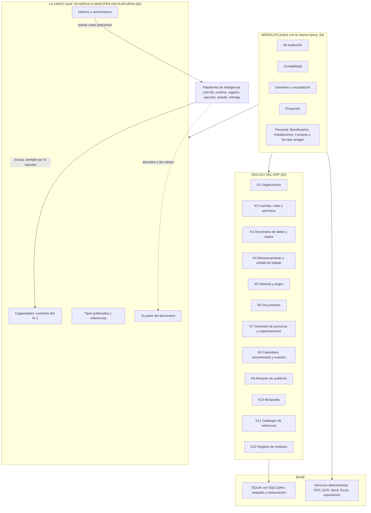
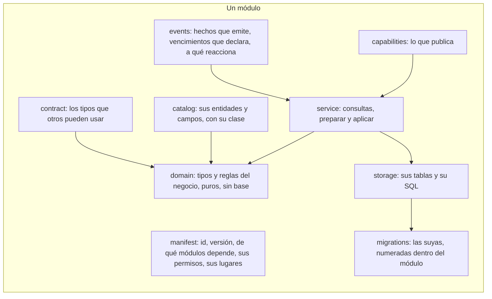
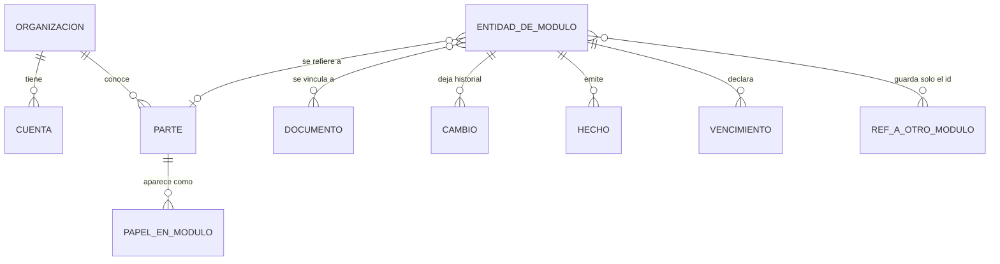
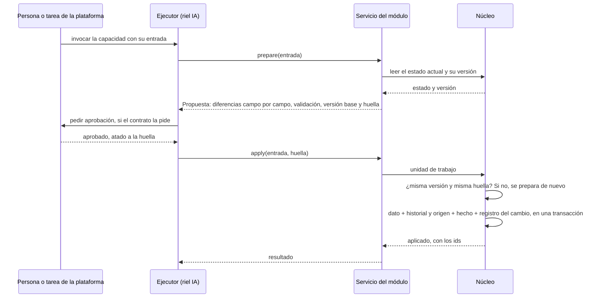

# Plano del ERP

**Aprobado por el líder el 2026-10-20, con las seis decisiones de la §12** (bloque ERP-7, [ADR-002](adr/ADR-002-el-nucleo-del-erp-y-la-forma-de-un-modulo.md)). Detalla, para el riel ERP, las cajas que le tocan en [los planos de SociAI](planos-de-sociai.md): la capa 2 (módulos y contratos), los servicios deterministas de la capa 4, la capa 5 (datos) y la parte de la capa 6 que es suya (cuentas, permisos y el almacén de la auditoría). No cambia los planos: los aterriza. Su par del lado de la IA es [el plano de la IA](plano-de-la-ia.md) (ADR-003), que en su §7 cuadra los dos punto por punto. Si algo de aquí choca con los planos, mandan los planos. Si este plano cambia, se cambia aquí primero, con su fila en la §13.

**Cómo se hizo.** Primero los planos y la [investigación](investigacion/README.md); el código no se consultó para decidir, solo al final para el veredicto de la §10. Nada se diseña para acomodar lo que ya existe.

**«Hacia adentro» y «hacia afuera»** se refieren a los módulos: cómo guarda un módulo sus datos y cómo se reparten entre módulos (§6). Lo que sale del programa (SAT, bancos, financiadores) todavía no se construye; la §6.3 solo fija la regla para que el núcleo ya lo tome en cuenta.

---

## 1. La respuesta corta

1. **Mi institución no es el núcleo.** Es un módulo más, el primero. El núcleo es lo que **todos** los módulos necesitan y **ninguno** posee: la organización, las cuentas y los permisos, el diccionario de datos, la forma de guardar y cambiar, el historial, los documentos, el directorio de personas y organizaciones, el calendario y los eventos, la auditoría y el registro de módulos.
2. **El núcleo está debajo de los módulos, nunca encima.** No conoce a ningún módulo. Hoy es al revés: `core/` es Mi institución más Inicio, y lee a los módulos por su `api` y sus `bridge`. Así cada módulo nuevo hace crecer el núcleo.
3. **Todos los módulos tienen la misma forma** (§4). Hacer un módulo nuevo es llenar esa forma; ni el núcleo ni la plataforma cambian.
4. **Hacia adentro, cada módulo es dueño de sus datos.** Hacia afuera solo existen cuatro puertas: sus capacidades, sus tipos publicados, sus hechos y su parte del diccionario (§6).
5. **Todo cambio de datos se prepara y luego se aplica** (§7), venga de una persona o de la IA. Es el punto donde la IA entra de forma nativa sin que el ERP sepa que existe.

---

## 2. Por qué Mi institución no puede ser el núcleo

| Si Mi institución fuera el núcleo | Con un núcleo aparte |
|---|---|
| Cada módulo depende de lo de adentro de Mi institución. | Cada módulo depende solo del núcleo y de los contratos que otro módulo publica. |
| El núcleo crece con cada módulo: hoy ya hay `core/bridge/staff`, `care`, `facilities` y `finance`, y `core/insights`. | El núcleo no cambia cuando llega un módulo. |
| Las reglas de la institución (patronato, CLUNI, cuentas bancarias) se mezclan con las de la plataforma (cuentas, historial, documentos). | Lo de la institución es negocio y vive en su módulo; lo común vive una vez en el núcleo. |
| «Inicio» y los resúmenes leen el código de los módulos. | Un resumen es una capacidad que combina otras, y la arma la plataforma. |

**Lo que sí es común a toda la institución, y por eso va al núcleo,** es la **organización** como dueña de la base: su id, su nombre corto y su tipo. Eso no es el perfil completo; el perfil es de Mi institución.

---

## 3. Las capas del ERP

### Reglas de dependencia

1. **La base no conoce el negocio.** El núcleo usa la base. Un módulo usa el núcleo y la base.
2. **El núcleo no conoce ningún módulo,** ni por su nombre. Lo que necesita de ellos se lo declaran (§4): sus campos, sus tipos de documento, sus vencimientos.
3. **Un módulo no usa otro módulo,** salvo los **tipos publicados** de ese módulo (`contract`) y sus **capacidades**, invocadas por el ejecutor. Nunca su `service`, su `storage` ni sus tablas.
4. **Las dependencias entre módulos se declaran** en el manifiesto y no pueden formar ciclos. Una prueba lo revisa.
5. **Nada de la IA en el ERP.** Ningún módulo ni el núcleo usa la plataforma de IA (regla del IA-1).
6. **Las pantallas no tienen comandos propios por módulo.** Todo entra por el runtime (regla 1 de los planos). Los únicos comandos de Tauri que quedan son la entrada al runtime y lo que pasa antes de la sesión (entrar, primer inicio, desbloquear).

**Propuesta: que el compilador haga cumplir estas reglas.** Hoy las vigila una prueba que lee el texto de los archivos (`architecture_tests.rs`). Con un *workspace* de Cargo, el núcleo y cada módulo son un *crate*, y una dependencia prohibida no compila (§12, D5).

---

## 4. La forma de un módulo

Es la plantilla que se repite. Un módulo que no la cumple no entra al registro.

| Parte | Qué lleva | Regla |
|---|---|---|
| `manifest` | id (`mi_institucion`, `contabilidad`), nombre, versión, módulos de los que depende, los permisos que define, sus lugares en el programa, si está encendido | Lo lee el registro de módulos (K12). |
| `contract` | Los tipos que otros módulos pueden usar: referencias (`CuentaContableRef`), enumeraciones, entradas y salidas de sus capacidades | Lo único que otro módulo puede importar. Cambiarlo es cambiar su versión. |
| `domain` | Entidades, valores y reglas | Puro: no abre la base ni conoce el núcleo, salvo sus tipos comunes (dinero, fechas, ids). Se prueba sin base. |
| `catalog` | Su parte del diccionario (K3): cada entidad, cada campo con su tipo, su regla, cuándo aplica, si es obligatorio y **su clase de dato** | Cada dato declara su clase **una sola vez** (ERP-2). |
| `storage` | Sus tablas, con su prefijo, y todo su SQL | Solo él escribe SQL sobre ellas. Ninguna llave foránea hacia las tablas de otro módulo; sí hacia el núcleo. |
| `migrations` | Sus migraciones, numeradas dentro del módulo | Nunca se editan. No chocan con las de otro módulo. |
| `service` | Los casos de uso: consultas, y para cada cambio un `prepare` y un `apply` | Escribe solo dentro de la unidad de trabajo del núcleo (K4). |
| `capabilities` | Los contratos (IA-1) sobre el `service` | Pocas y por intención, no una por tabla ([investigación](investigacion/investigacion-externa.md), §3.4). |
| `events` | Los hechos que emite (`donativo_registrado`), los vencimientos que declara y a qué hechos de otros módulos reacciona | Un hecho lleva ids, nunca datos personales. |

**Una prueba de conformidad corre sobre cada módulo registrado,** sin escribirla de nuevo para cada uno:
- el manifiesto es válido y sus dependencias existen, sin ciclos;
- sus migraciones se aplican sobre una base vacía;
- cada campo de su catálogo tiene clase;
- cada capacidad pasa la revisión del registro (IA-1) y sus clases coinciden con las de los campos que toca;
- sus tablas llevan su prefijo, y nadie más las toca.

**Un módulo de muestra** vive en las pruebas como referencia viva de la plantilla.

---

## 5. El núcleo, pieza por pieza

| | Pieza | Qué hace | Qué necesita de los módulos |
|---|---|---|---|
| **K1** | Organización | La institución dueña de la base: id, nombre corto, tipo. Va en toda petición para el permiso «sobre la institución» de los planos. | Nada. |
| **K2** | Cuentas, roles y permisos | Cuentas, sesión, bloqueo y recuperación. Los **permisos los declara cada módulo** en su manifiesto, por su id (`contabilidad.polizas.registrar`), y una capacidad nombra el suyo por ese id (ADR-003, A2); los roles del núcleo los agrupan y dicen qué **clases de datos** ve cada rol, y el núcleo decide si una cuenta puede. | Sus permisos. |
| **K3** | Diccionario de datos | La única descripción de cada entidad y campo: tipo, regla, cuándo aplica, si es opcional, esperado u obligatorio, y su clase. De ahí salen la validación, los formularios, lo que falta por llenar, lo protegido en el historial, la exportación y la clase que usa la política de la IA. Un campo se nombra por su id completo (`modulo.entidad.campo`). Es la «capa semántica» de la investigación. | Su catálogo, en su manifiesto. |
| **K4** | Almacenamiento y unidad de trabajo | La conexión cifrada, las migraciones por dueño (cada módulo y la plataforma de IA, con sus tablas `ai_`; ADR-003, A3), los ids, la versión de cada registro y la **unidad de trabajo**: una sola transacción que escribe el dato, su historial, su hecho y su registro de cambio, o nada (§7). | Sus tablas y sus migraciones. |
| **K5** | Historial y origen | Para cualquier entidad de cualquier módulo: quién cambió qué, cuándo, desde dónde (persona, documento con página, cálculo o tarea de la plataforma con su id). Solo crece. Lo protegido dice que cambió, no el valor; es protegido todo campo cuya clase no sea `public` ni `internal`. | Nada: se escribe solo al aplicar. |
| **K6** | Documentos | El almacén de archivos, su texto por página, la búsqueda por palabras, sus vigencias y el **vínculo con cualquier entidad** de cualquier módulo. | Sus tipos de documento (Mi institución declara «acta constitutiva»; Contabilidad, «CFDI»). |
| **K7** | Directorio | Una sola ficha mínima por persona u organización (nombre, tipo, RFC o CURP, contacto), y **en qué módulos aparece y con qué papel**: donante, beneficiario, empleado, proveedor, integrante del patronato. Lo propio de cada papel vive en su módulo. Evita la doble captura. | Los papeles que define. |
| **K8** | Calendario, vencimientos y eventos | La bandeja de hechos (escrita en la misma transacción que el cambio), los vencimientos calculados sin IA y el aviso cuando algo vence. Los hechos y los avisos entran a la plataforma como peticiones. | Sus hechos y sus reglas de vencimiento. |
| **K9** | Almacén de auditoría | Donde quedan, sin datos personales, los accesos, las denegaciones, los cambios y los cierres de tarea, con el id de correlación. La plataforma escribe ahí los de sus tareas. | Nada. |
| **K10** | Búsqueda | Un índice común: los documentos y una etiqueta legible de cada entidad, con su referencia y su clase. Lo alimenta el núcleo al aplicar un cambio; nadie lee tablas ajenas para buscar. | La etiqueta de sus entidades. |
| **K11** | Catálogos de referencia | Datos que no son de nadie: estados y municipios, regímenes y usos del SAT, código agrupador de cuentas, bancos, monedas. Versionados. | Nada. |
| **K12** | Registro de módulos | Junta los manifiestos (como el registro de capacidades del IA-1, sin lista), revisa sus dependencias y sabe cuáles están encendidos. Sustituye a `HIDDEN`. | Su manifiesto. |

**Los tipos comunes** (en el núcleo, para que todos hablen igual): `Dinero` en centavos con su moneda, fechas y periodos, ids, referencias a entidades (`Ref { módulo, entidad, id }`) y los identificadores mexicanos con su dígito verificador (RFC, CURP, CLABE).

**Lo que el núcleo calcula para cualquier módulo, sin que el módulo lo programe:**
- **qué falta por llenar,** de cualquier entidad, con su diccionario;
- **la validación** de una entrada contra el diccionario;
- **el historial** de un dato;
- **los vencimientos** que salen de sus reglas.

---

## 6. Los datos: hacia adentro y hacia afuera

### 6.1 Quién es dueño de qué

| Del núcleo | De cada módulo |
|---|---|
| Organización, cuentas, roles, directorio, documentos, historial, hechos, vencimientos, auditoría, índice de búsqueda, catálogos de referencia | Sus entidades y sus reglas. Ejemplos: el perfil y el patronato (Mi institución), las pólizas (Contabilidad), los donativos (Donantes), los proyectos (Proyectos) |

### 6.2 Hacia adentro: cómo guarda un módulo

1. **Tablas con columnas reales** para lo que tiene reglas, relaciones o consultas. El diccionario describe cada columna; no hay una bolsa JSON genérica para los datos principales.
2. **Cada registro lleva** su id, su versión (sube con cada cambio), cuándo se creó y cuándo cambió. El origen y el historial no van en columnas repetidas en cada tabla (hoy `origin`, `source_ref`, `confirmed_at` y `confirmed_by` están en casi todas): van en K5, una vez para todos.
3. **El dinero, en centavos** con su moneda. Hoy son pesos enteros, y la contabilidad no se puede llevar así (§12, D3).
4. **Borrar es archivar.** El borrado definitivo es una solicitud que aprueba quien tiene permiso, genérica para cualquier entidad (hoy la lista de lo que se puede pedir borrar está escrita a mano). Lo que la ley obliga a conservar, como la contabilidad, no se borra antes de su plazo.
5. **Campos propios de la institución** (los que hoy tienen Personal y Beneficiarios): los ofrece el núcleo sobre el diccionario, con clase obligatoria, no cada módulo por su lado.

### 6.3 Hacia afuera: las cuatro puertas

| Puerta | Para qué | Ejemplo |
|---|---|---|
| **Capacidades** | Que la plataforma, una pantalla o un flujo de otro módulo consulten o cambien algo | `mi_institucion.que_falta`, `contabilidad.registrar_poliza` |
| **Tipos publicados** | Que otro módulo guarde una referencia o entienda una salida | Proyectos guarda un `FondoRef` de Contabilidad |
| **Hechos** | Avisar que algo pasó, para que otros reaccionen | `donativo_registrado` → Contabilidad prepara la póliza y el recibo |
| **Diccionario** | Que el núcleo valide y la plataforma sepa la clase de cada dato | La clase del RFC de un donante |

**Las reglas de la distribución:**
- **Un dato vive en un solo lugar.** Otro módulo guarda la **referencia**, no una copia. Si necesita mostrarlo, lo consulta por capacidad.
- **Entre módulos no hay llaves foráneas.** El dueño publica si una referencia existe y emite un hecho cuando la archiva; quien la guarda reacciona.
- **Una vista que junta varios módulos** (Inicio, un informe anual) es una capacidad que combina otras capacidades, nunca SQL que cruce tablas.
- **Hacia afuera del programa** (SAT, bancos, financiadores, Excel): las importaciones y exportaciones son capacidades de un módulo sobre los servicios deterministas de la base. Una salida externa es una acción sensible: pide aprobación.

---

## 7. Un cambio: preparar, aprobar y aplicar

Es la pieza que hace que la IA conviva con el ERP sin que el ERP la conozca. **Una persona que guarda un formulario y la IA que propone valores recorren el mismo camino.**

- **La propuesta es un objeto del ERP,** no de la IA: dice qué cambia (antes y después), qué no pasa la validación del diccionario y contra qué versión se preparó.
- **La huella** sale de la entrada y de la versión base. Si la entrada o el dato cambiaron después de aprobar, la huella ya no coincide y hay que volver a confirmar (§3.5 de los planos).
- **El origen viaja con el cambio:** «lo escribió la persona», «del acta, página 3», «calculado», «propuesto en la tarea T y aceptado por la persona». Es la evidencia que la persona ve.
- **Sustituye a las propuestas por campo** de hoy (`ai_proposal`).

---

## 8. Lo que el ERP le da a la IA para que sea nativa

Sin que ningún módulo llame a la IA:

| El ERP da | La plataforma lo usa para |
|---|---|
| Capacidades con esquema que sale del diccionario | Enrutar y elegir pocas herramientas por intención |
| La clase de cada dato, declarada una vez | Aplicar la política antes del modelo, al armar el contexto y a la salida |
| Propuestas con diferencias, huella y versión | La aprobación atada a los parámetros |
| Historial con origen y página | Dar evidencia en la respuesta |
| «Qué falta», calculado por el núcleo | Preguntar a la persona solo lo necesario |
| Los campos que faltan, como campos del diccionario (con opciones) | Preguntar con opciones y no con texto libre (*elicitation*), según la investigación (§1.4) |
| Hechos y vencimientos | Abrir tareas y avisos sin que la persona esté en la pantalla |
| Documentos con su texto por página | El conocimiento documental del gestor de contexto |

---

## 9. El mapa funcional de un ERP para una OSC

Los módulos siguen apagados. Esto es para que el núcleo sirva a todos desde el principio, no un plan de construcción.

| Módulo | Qué cubre | Hoy |
|---|---|---|
| **Mi institución** | Perfil, gobierno (patronato, representantes y poderes), registros legales y su vigencia (CLUNI, donataria autorizada, constancia de actividades), cuentas bancarias, población atendida en agregado, expediente legal | El más completo, mezclado con el núcleo y la IA vieja. **Faltan** las vigencias de los registros y los poderes. |
| **Contabilidad** | Catálogo de cuentas con código agrupador del SAT, pólizas de partida doble, CFDI recibidos y emitidos, **fondos restringidos** (lo donado para un fin), conciliación bancaria, estados financieros, límite del 5 % de gastos de administración, datos de la declaración anual y de transparencia | **No existe** (`finance` es un balance simple). |
| **Donantes y recaudación** | Donantes y financiadores, donativos en efectivo y en especie, recibos deducibles, campañas | **No existe.** |
| **Proyectos** | Convocatorias, proyectos, marco lógico, presupuesto, cronograma, informes al financiador | **Salió** (etiqueta `proyectos-rust-congelado`). Se rehace sobre el núcleo. |
| **Personal** | Plantilla, puestos, nómina con prestaciones, **voluntariado** (más del 40 % del trabajo del sector) | Congelado. Falta el voluntariado. |
| **Beneficiarios** | Padrón, atención, lista de espera, **consentimiento por escrito** (LFPDPPP art. 8) | Congelado. Falta el consentimiento. |
| **Instalaciones y activos** | Sitios, equipo, inventario, activos fijos | Congelado. |
| **Compras y comprobación** | Proveedores, cotizaciones, órdenes y la comprobación de gastos ante el financiador | **No existe.** |

**Cumplimiento no es un módulo:** cada obligación la declara el módulo dueño de sus datos (la constancia, Mi institución; la declaración anual, Contabilidad), y el calendario del núcleo (K8) las junta. Así no nace un módulo que lea a todos.

**El flujo que más pesa en una OSC** cruza cuatro módulos y por eso prueba el diseño: un donativo (Donantes) entra a un fondo restringido (Contabilidad), el fondo financia un proyecto (Proyectos), el proyecto gasta con comprobante (Compras y Contabilidad), y el informe al financiador y la transparencia salen de ahí. Todo por referencias, hechos y capacidades.

---

## 10. El código de hoy frente a este plano (riel ERP)

Para depurar el código, junto con el riel IA. Mismos veredictos que [el código frente a los planos](codigo-frente-a-los-planos.md).

| Código | Va a | Veredicto |
|---|---|---|
| `common/forms.rs` (campos, tipos, reglas, sensibilidad) | K3 Diccionario | **Refactor.** Describe entidades, no solo formularios. `Sensitivity` se vuelve la clase única del IA-3; `AiUse` sale, porque qué ve la IA es política, no una propiedad del dato. |
| `common/ids.rs`, `common/dates.rs` | Tipos comunes del núcleo | **Se conservan.** |
| `core/history.rs` (`core_field`, `core_change`) | K5 Historial | **Refactor.** De los campos de Mi institución a cualquier entidad, con el id de la tarea. |
| `core/access` | K2 | **Se conserva**; los permisos pasan a ser de los módulos y por clase de dato. |
| `core/archive`, `core/records`, `documents/` | K6 Documentos | **Refactor.** El almacén y la búsqueda al núcleo; la lista de documentos del expediente legal, a Mi institución. `documents/` queda como servicios de la base. |
| `core/reader` (tipos y datos por frases y expresiones regulares) | — | **Se retira** cuando haya lectura sobre la plataforma. No es la base del reconocimiento. |
| `core/proposals.rs` | §7 Preparar y aplicar | **Se retira** al llegar la aprobación atada a la huella. |
| `core/bridge`, `core/insights`, `core/overview.rs`, `core/snapshot.rs` | Capacidades que combinan otras | **Se retiran:** son el núcleo leyendo a los módulos. |
| `core/modules.rs` (`HIDDEN`) | K12 Registro de módulos | **Se retira.** |
| `core/places.rs`, `core/manual` | Lugares en el manifiesto de cada módulo; el manual se queda | **Refactor.** |
| `core/profile`, `core/institution`, `core/protected`, `core/onboarding` | Módulo Mi institución | **Refactor** a la forma de módulo. Del primer inicio, crear la organización y la primera cuenta es del núcleo; pedir lo indispensable, de Mi institución. |
| `core/ai_sheet.rs` | — | **Se retira** (lo sustituye el gestor de contexto, riel IA). |
| `storage/` | K4 y base | **Se conserva.** Las migraciones pasan a ser por módulo. |
| `audit/` | K9 | **Refactor:** id de correlación, tarea, capacidad y resultado. |
| `modules/hr`, `care`, `facilities` | Sus módulos | **Congelados.** Al encenderse, se pasan a la forma de módulo. |
| `modules/finance` | — | **Se retira** cuando exista Contabilidad. |
| `commands/` (134 comandos) | Entrada al runtime y lo de antes de la sesión | **Se retiran** a medida que su capacidad corre en la plataforma. |

---

## 11. Cómo se construye (bloques propuestos del riel ERP)

El esqueleto primero, probado con **una** capacidad de punta a punta, igual que el riel IA. Mi institución es el primer módulo que se hace con la forma nueva, y con ella se prueba el núcleo.

| Orden | Bloque | Terminado cuando (resumen) |
|---|---|---|
| 1 | **ERP-7 · El plano del ERP y su ADR** (este documento) | El líder aprueba el plano y las decisiones de la §12. |
| 2 | **ERP-8 · La forma de un módulo y el registro de módulos** (K12, K4 en parte) | El *workspace* con el núcleo y un módulo de muestra; migraciones por módulo; la prueba de conformidad; las reglas de dependencia las hace cumplir el compilador. |
| 3 | **ERP-9 · Preparar y aplicar, con historial y origen** (K4, K5) | Un cambio del módulo de muestra se prepara, se rechaza si cambió la versión o la huella, y al aplicarse deja dato, historial y hecho en una transacción. Junto con el IA-2, que trae la aprobación. |
| 4 | **ERP-2 · El diccionario y la clase de cada dato** (K3) | Validación y «qué falta» calculados por el núcleo para cualquier entidad; ningún campo sin clase. |
| 5 | **ERP-1 · Mi institución sobre el núcleo** | El perfil y «qué me falta» corren como módulo nuevo y como capacidad; la versión vieja de esas piezas sale. Desbloquea el IA-4. |
| 6 | **Documentos en el núcleo** (K6) | Cualquier entidad vincula documentos; los tipos los declara cada módulo. |
| 7 | **ERP-3 · Calendario, vencimientos y eventos** (K8) | Las obligaciones de Mi institución vencen sin IA y avisan por la entrega común. |
| 8 | **Directorio** (K7, decisión D2) | Una persona u organización aparece en dos papeles sin capturarse dos veces. |

Los bloques ERP-1, ERP-2 y ERP-3 que ya estaban en el tablero se vuelven los pasos 5, 4 y 7, ya sobre el núcleo, en vez de envolver el código viejo. Los pasos 6 y 8 entran al tablero cuando haya lugar en el Backlog.

**Lo que se pide al riel IA:**
- **IA-5** (pedido por el ERP-1): que un módulo, como *crate* aparte, pueda declarar sus capacidades sin depender de la app, y con los permisos que él mismo declara (K2);
- **con el ERP-2,** cuando el diccionario exista: que «falta información de la persona» pueda nombrar campos del diccionario, para que el chat pregunte con opciones;
- **cuando llegue el segundo módulo:** que un flujo determinista pueda invocar capacidades de otro módulo por el ejecutor, con sus permisos y su auditoría. Ninguno de estos dos se pide todavía: el primero necesita el diccionario, y el segundo, un módulo que use a otro.

---

## 12. Las decisiones del líder (2026-10-20)

Las seis se aprobaron como se recomendaban. Las recoge el [ADR-002](adr/ADR-002-el-nucleo-del-erp-y-la-forma-de-un-modulo.md).

| | Decisión | Se aprobó | Por qué |
|---|---|---|---|
| **D1** | Mi institución es un módulo y el núcleo va aparte | **Sí** | §2. Sin esto, cada módulo hace crecer el núcleo. |
| **D2** | Un directorio común de personas y organizaciones en el núcleo | **Sí, con la ficha mínima** | La doble captura es de las primeras causas de abandono ([investigación](investigacion/investigacion-externa.md), §1.4). Riesgo: junta datos personales; se controla porque cada rol ve solo los papeles de sus módulos (un contador ve donantes, no beneficiarios). |
| **D3** | El dinero en centavos, con su moneda, en todo el ERP | **Sí** | La contabilidad y los CFDI llevan centavos. Hoy son pesos enteros. |
| **D4** | Una base cifrada por institución, con la organización explícita en cada petición | **Sí** | Así es hoy, y el permiso «sobre la institución» de los planos queda listo por si un día hay varias. |
| **D5** | Un *workspace* de Cargo: el núcleo y cada módulo nuevo como *crate* | **Sí** | La modularidad la garantiza el compilador, no una prueba que lee texto. El código viejo se queda en la app hasta retirarse. Costo: reorganizar la compilación una vez; SQLCipher se compila una sola vez para todos. |
| **D6** | Las pantallas dejan de tener comandos por módulo; todo pasa por el runtime | **Sí** (ya lo dicen los planos) | Vale también para lo determinista, como guardar un formulario. |

---

## 13. Ajustes hechos a este plano

| Fecha | Ajuste |
|---|---|
| 2026-10-20 | Primera versión, aprobada con las decisiones D1 a D6 (ERP-7, ADR-002). |
| 2026-10-21 | Cuadra con [el plano de la IA](plano-de-la-ia.md) (ADR-003, pedido en el ERP-10): el plano lo enlaza; en K2 el permiso se nombra por su id (A2), y en K4 las migraciones son por dueño, con la plataforma como un dueño más (A3). Bloque ERP-8. |
| 2026-10-23 | K3 y K5 se precisan con el diccionario (ERP-2): el catálogo de cada módulo va en su manifiesto y lo revisa el registro; un campo es opcional, esperado (cuenta en «qué falta», nunca impide guardar) u obligatorio; se nombra por su id completo, y lo protegido en el historial sale de su clase. Las clases son las provisionales del núcleo hasta el ADR del IA-3. |
