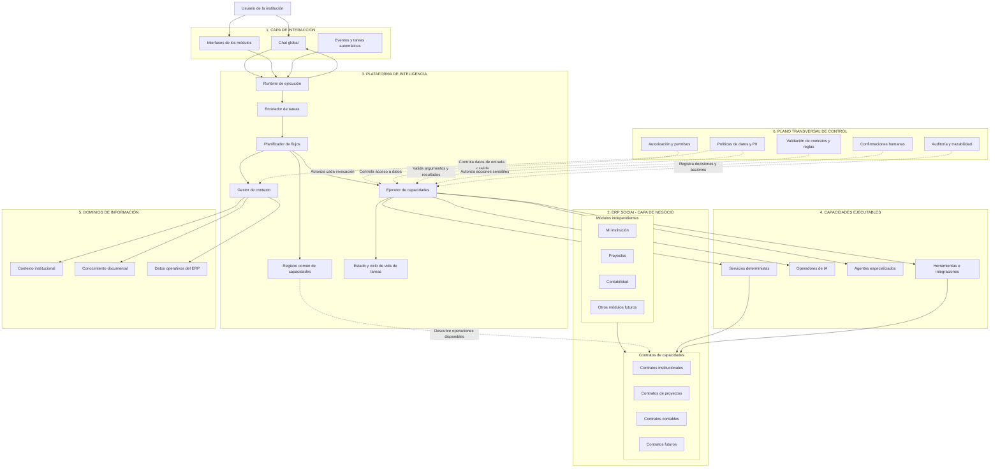
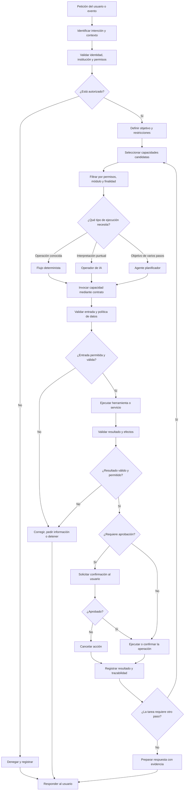

# Planos de SociAI

Los dos planos con los que se construye SociAI:
- **El plano global** dice qué partes tiene el sistema y cómo se conectan.
- **El plano operativo** dice qué pasa desde que llega una petición hasta que se responde.

Este documento es la referencia. Si un plano cambia, se cambia aquí primero. Los diagramas están en Mermaid y se ven dibujados en Obsidian y en GitHub.

---

## 1. Plano global

### Las seis capas

| Capa | Qué es |
|---|---|
| **1. Interacción** | Por donde entra todo: el chat global, las pantallas de los módulos y los eventos que se disparan solos (un vencimiento, una tarea programada). |
| **2. ERP (negocio)** | Los módulos (Mi institución, Proyectos, Contabilidad y los que vengan). Cada módulo publica sus **contratos de capacidades**: las operaciones que ofrece, con qué entra y qué sale. |
| **3. Plataforma de inteligencia** | El motor común. El **runtime** recibe la petición, el **enrutador** entiende qué se pide y el **planificador** arma los pasos. Para eso consulta el **registro** de capacidades y el **gestor de contexto**. El **ejecutor** corre cada paso, y el **estado** lleva cómo va cada tarea. |
| **4. Capacidades ejecutables** | Lo que de verdad hace el trabajo: servicios deterministas (código), operadores de IA (una interpretación puntual), agentes especializados (varios pasos) y herramientas o integraciones. |
| **5. Dominios de información** | De dónde sale el contexto: el perfil de la institución, sus documentos y los datos del ERP. |
| **6. Control transversal** | Lo que vigila cada ejecución: permisos, política de datos personales, validación, confirmación de la persona y auditoría. |

### Reglas que salen del plano

1. **Todo entra por el mismo camino.** El chat, las pantallas y los eventos llegan al mismo runtime. Ninguna pantalla llama a la IA ni a otro módulo por su cuenta.
2. **Un módulo se conecta publicando contratos.** El registro descubre lo que cada módulo ofrece. Un módulo nuevo es el módulo más sus contratos: la plataforma de inteligencia no cambia.
3. **La IA no toca los datos directamente.** Solo los servicios deterministas y las herramientas llegan a los contratos. Los operadores y los agentes actúan a través de ellos, siempre por medio del ejecutor.
4. **El control vive en un solo punto: el ejecutor.** Cada invocación pasa por los permisos, la política de datos, la validación, la confirmación cuando hace falta y la auditoría. Ninguna capacidad se los salta.
5. **El contexto se filtra antes de llegar a la IA.** El gestor de contexto arma lo que hace falta desde los tres dominios, y la política de datos decide qué puede salir.

---

## 2. Plano operativo: de una petición a una acción

### Los pasos

1. **Entrada y permisos.** Se entiende qué se pide y se revisa quién lo pide, de qué institución y con qué permisos. Si no está autorizado, se niega y queda registrado.
2. **Objetivo.** Se fija qué hay que lograr y con qué restricciones.
3. **Elegir capacidades.** Se buscan las capacidades que sirven, y **el código** quita las que no están permitidas para esa persona, ese módulo o esa finalidad. La IA solo elige entre lo que queda.
4. **El nivel de ejecución.** Si la operación es conocida, es un flujo determinista, sin IA. Si hay que interpretar algo puntual, un operador de IA. Si el objetivo es de varios pasos, un agente.
5. **Revisar antes.** Toda invocación pasa por su contrato: se validan los argumentos y la política de datos. Si algo falla, se corrige, se le pide información a la persona o se detiene.
6. **Ejecutar y revisar después.** Se ejecuta y se valida el resultado y sus efectos.
7. **Confirmar.** Si la acción lo requiere, la persona aprueba o cancela.
8. **Registrar y seguir.** Todo resultado queda registrado. Si la tarea necesita otro paso, se vuelve a elegir capacidades, no a empezar.
9. **Responder con evidencia.** La respuesta dice de dónde sale cada dato.

**Una interpretación que hay que confirmar.** En el plano, «Ejecutar herramienta o servicio» va **antes** de la confirmación, y el cambio se hace en «Ejecutar o confirmar la operación». Lo leo así: cuando una acción requiere aprobación, la primera ejecución solo **prepara** el cambio (una propuesta), y nada se guarda hasta que la persona aprueba.

---

## 3. Ajustes hechos a los planos

| Fecha | Plano | Ajuste |
|---|---|---|
| 2026-10-20 | Operativo | Se agregó la flecha `AUTH --> DENY`. En el original, la pregunta «¿Está autorizado?» no estaba conectada a la validación de permisos y quedaba suelta en el dibujo. |

---

## 4. Puntos abiertos

1. **La intención se identifica antes de los permisos.** Si identificar la intención usa IA, el texto de la persona llega a la IA antes de pasar por la política de datos. En el plano global, la política solo vigila al gestor de contexto y al ejecutor. ¿La política vigila también al enrutador, o se validan primero la identidad y los permisos?
2. **Los errores no quedan registrados.** «Denegar» y «Cancelar» sí se registran, pero un error va directo a «Responder al usuario». Además, «Corregir» podría volver a intentar el paso en lugar de terminar. ¿El error pasa por la auditoría? ¿Una corrección regresa a «Invocar capacidad»?
3. **El ciclo de pasos no tiene límite.** «¿La tarea requiere otro paso?» puede volver a empezar sin fin. ¿Se pone un tope de pasos y de gasto por tarea, a cargo de «Estado y ciclo de vida de tareas»?
4. **La respuesta solo regresa al chat.** En el plano global, el runtime contesta al chat, pero no a las pantallas de los módulos ni a los eventos. ¿Falta `RUNTIME --> UI`?
5. **Confirmar la interpretación** de «ejecutar» antes de aprobar (final de la §2).
