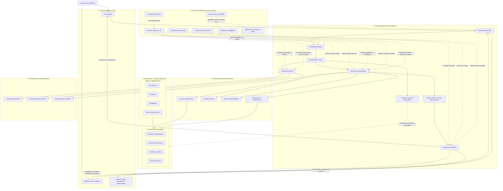

# Planos de SociAI

Los dos planos con los que se construye SociAI:
- **El plano global** dice qué partes tiene el sistema y cómo se conectan.
- **El plano operativo** dice qué pasa desde que llega una petición hasta que se entrega el resultado.

Este documento es la referencia. Si un plano cambia, se cambia aquí primero. Los diagramas están en Mermaid y se ven dibujados en Obsidian y en GitHub.

**La idea central:** hay **una sola plataforma de inteligencia** para todo el ERP. Los módulos no tienen su propio equipo de IA: publican sus capacidades, y la plataforma decide cómo usarlas.

**Cómo se arma por dentro el ERP** (el núcleo, la forma de un módulo y cómo se reparten los datos) está en [el plano del ERP](plano-del-erp.md), que aterriza estos planos para las capas 2, 4, 5 y 6.

**Cómo se arma por dentro la plataforma de IA** (sus piezas, la tarea, la entrega, la política y cómo se acopla al ERP) está en [el plano de la IA](plano-de-la-ia.md), que aterriza estos planos para las capas 3, 4 y 6.

---

## 1. Plano global

### Las seis capas

| Capa | Qué es |
|---|---|
| **1. Interacción** | Por donde entra y sale todo: el chat global, las pantallas de los módulos, y los eventos (un vencimiento, una tarea programada, un aviso de que algo terminó). |
| **2. ERP (negocio)** | Los módulos (Mi institución, Proyectos, Contabilidad y los que vengan). Cada módulo publica sus **contratos de capacidades**: las operaciones que ofrece, con qué entra y qué sale. |
| **3. Plataforma de inteligencia** | El motor común: • El **runtime** recibe la petición. • El **enrutador** entiende qué se pide y propone capacidades. • El **planificador** arma los pasos, consultando el **registro** de capacidades y el **gestor de contexto**. • El **ejecutor** corre cada paso. • El **estado** lleva cómo va cada tarea y sus límites. • La **entrega** lleva el resultado al canal que corresponde. |
| **4. Capacidades ejecutables** | Lo que de verdad hace el trabajo: servicios deterministas (código), operadores de IA (una interpretación puntual), agentes especializados (varios pasos) y herramientas o integraciones. |
| **5. Dominios de información** | De dónde sale el contexto: el perfil de la institución, sus documentos y los datos del ERP. |
| **6. Control transversal** | Lo que vigila cada paso: • quién es la persona (autenticación); • qué puede hacer (autorización); • qué clase tiene cada dato y qué política le toca; • la validación, la confirmación de la persona y la auditoría. |

### Reglas que salen del plano

1. **Todo entra por el mismo camino.** El chat, las pantallas y los eventos llegan al mismo runtime. Ninguna pantalla llama a la IA ni a otro módulo por su cuenta.
2. **Una sola plataforma de IA para todo el ERP.** Un módulo se conecta publicando contratos, y el registro descubre lo que ofrece. Un módulo nuevo es el módulo más sus contratos: la plataforma no cambia, y el módulo no trae su propia IA.
3. **La IA no toca los datos directamente.** Solo los servicios deterministas y las herramientas llegan a los contratos. Los operadores y los agentes actúan a través de ellos, siempre por medio del ejecutor.
4. **Conocer la intención no da permisos.** La identidad y la sesión se validan antes de que la IA vea nada. El enrutador propone capacidades, pero no autoriza ni lee datos del negocio. Los permisos se revisan sobre la capacidad ya resuelta, otra vez justo antes de ejecutar, y otra vez antes de entregar.
5. **El control vive en el plano común, no en cada agente.** Permisos, clasificación, política, validación, confirmación y auditoría se escriben una vez y los usan todos. No se duplican con instrucciones del *prompt* ni con expresiones regulares de cada agente.
6. **El contexto se filtra antes de llegar a la IA.** El gestor de contexto da solo la información autorizada y mínima para la tarea.
7. **Ejecutar no es entregar.** La lógica de negocio no depende de una pantalla. El resultado sale por un contrato común de entrega, con el id de la tarea y su destino. Si llega después, se puede consultar o se avisa.
8. **Cada tarea tiene límites.** El estado de la tarea controla:
   - pasos, reintentos, gasto de IA y tiempo;
   - que la tarea siga activa antes de cada invocación.

   No depende de que el agente decida parar.

---

## 2. Plano operativo: de una petición a una acción

```mermaid
flowchart TD

    START["Petición del usuario o evento"]
    AUTHN["Validar identidad y sesión"]
    SESSION{"¿Sesión válida?"}
    CLASSIFY["Clasificar los datos del texto y aplicar la política previa: privacidad, sensibilidad, proveedor y límites de uso"]
    MAYAI{"¿Puede ir al modelo?"}
    NOAI["Atender sin IA o detener"]
    IDENTIFY["Identificar intención y proponer capacidades"]
    TASK["Abrir la tarea: objetivo, restricciones, límites e id de correlación"]

    START --> AUTHN
    AUTHN --> SESSION
    SESSION -->|No| DENY["Denegar"]
    SESSION -->|Sí| CLASSIFY
    CLASSIFY --> MAYAI
    MAYAI -->|No| NOAI
    MAYAI -->|"Sí, con lo permitido"| IDENTIFY
    IDENTIFY --> TASK

    TASK --> SELECT["Seleccionar capacidades candidatas"]
    SELECT --> FILTER["Filtrar por módulo y finalidad"]
    FILTER --> AUTHZ{"¿Permiso sobre la acción, el recurso, la institución y los datos?"}
    AUTHZ -->|No| DENY
    AUTHZ -->|Sí| PLAN{"¿Qué tipo de ejecución necesita?"}

    PLAN -->|Operación conocida| FLOW["Flujo determinista"]
    PLAN -->|Interpretación puntual| OP["Operador de IA"]
    PLAN -->|Objetivo de varios pasos| AGENT["Agente planificador"]

    FLOW --> CONTEXT["Recuperar solo el contexto autorizado y mínimo"]
    OP --> CONTEXT
    AGENT --> CONTEXT

    CONTEXT --> LIMITS{"¿La tarea sigue activa, con presupuesto y dentro de sus límites?"}
    LIMITS -->|No| LIMIT["Finalizar por límite"]
    LIMITS -->|Sí| INVOKE["Invocar capacidad mediante contrato"]

    INVOKE --> PRECHECK["Validar entrada y política de datos; volver a comprobar permisos"]
    PRECHECK --> PREOK{"¿Entrada permitida y válida?"}

    PREOK -->|Sí| EXECUTE["Ejecutar la consulta o transformación, o preparar el cambio"]
    PREOK -->|No| FAIL{"¿Qué falló?"}

    EXECUTE --> RESULT["Validar resultado y efectos"]
    RESULT --> SAFE{"¿Resultado válido y permitido?"}
    SAFE -->|No| FAIL

    FAIL -->|Argumentos corregibles| RETRY{"¿Se permite reintentar? Límite e idempotencia"}
    RETRY -->|Sí| LIMITS
    RETRY -->|No| TERMINAL["Error terminal"]
    FAIL -->|Falta información de la persona| ASK["Pausar la tarea y pedir la información"]
    FAIL -->|No recuperable| TERMINAL

    SAFE -->|Sí| SIDE{"¿Requiere aprobación?"}
    SIDE -->|No| COMMIT["Comprobar permisos y ejecutar o confirmar la operación"]
    SIDE -->|Sí| HUMAN["Pedir confirmación de la acción concreta y sus parámetros"]
    HUMAN --> APPROVED{"¿Aprobado?"}
    APPROVED -->|No| CANCEL["Cancelar la acción"]
    APPROVED -->|Sí| SAME{"¿Los parámetros siguen iguales?"}
    SAME -->|No| HUMAN
    SAME -->|Sí| COMMIT

    COMMIT --> STEP["Registrar el paso: capacidad, resultado e ids"]
    CANCEL --> STEP
    STEP --> MORE{"¿La tarea requiere otro paso?"}
    MORE -->|Sí| SELECT
    MORE -->|No| RESPONSE["Preparar respuesta con evidencia"]

    RESPONSE --> CLOSE["Registrar el cierre: terminada, pausada, denegada, por límite o con error; motivo e ids, sin datos personales"]
    ASK --> CLOSE
    DENY --> CLOSE
    NOAI --> CLOSE
    LIMIT --> CLOSE
    TERMINAL --> CLOSE

    CLOSE --> OUT["Controles de salida: permiso y política de datos"]
    OUT --> DELIVER["Entregar al canal: chat, pantalla o notificación, con el id de la tarea"]
    DELIVER --> END["Fin del turno"]
    END -. "La persona contesta: se reanuda la misma tarea" .-> START
```

### Los pasos

1. **Identidad antes que nada.** Se valida quién es y que su sesión esté abierta. Sin eso, se niega y se registra.
2. **Política previa.** Antes de que el texto llegue a un modelo, se clasifican sus datos y se decide qué puede ir, según privacidad, sensibilidad, proveedor y límites de uso. Si nada puede ir, se atiende sin IA o se detiene.
3. **Intención.** El enrutador entiende qué se pide y propone capacidades. No autoriza nada ni lee datos del negocio.
4. **Abrir la tarea.** Se fijan el objetivo, las restricciones y los límites, con un id de correlación que acompaña todo lo demás.
5. **Elegir y autorizar.** Se buscan las capacidades que sirven y se filtran por módulo y finalidad. Después se revisa el permiso sobre la acción, el recurso, la institución y los datos concretos. La IA solo elige entre lo que queda.
6. **El nivel de ejecución.** Si la operación es conocida, es un flujo determinista, sin IA. Si hay que interpretar algo puntual, un operador de IA. Si el objetivo es de varios pasos, un agente.
7. **Contexto mínimo.** Se trae solo la información autorizada y necesaria.
8. **Límites antes de cada invocación.** La tarea debe seguir activa, con presupuesto y dentro de sus límites de pasos, reintentos y tiempo. Si no, termina de forma controlada.
9. **Revisar antes.** Toda invocación pasa por su contrato: se validan los argumentos y la política de datos, y se vuelven a comprobar los permisos.
10. **Ejecutar.** Las consultas y transformaciones autorizadas corren solas. Una modificación primero se **prepara**.
11. **Cuando algo falla:**
    - un argumento corregible se reintenta, solo si quedan intentos y, si la operación tiene efectos, sin repetirla cuando el resultado anterior es incierto;
    - si falta información de la persona, la tarea se pausa y se le pide (nunca se inventa);
    - lo demás es un error terminal.
12. **Confirmar.** Las acciones sensibles, externas o irreversibles piden aprobación explícita de la acción concreta y sus parámetros. Si algo cambia después, hay que volver a confirmar. Que el agente decida seguir nunca cuenta como autorización de la persona.
13. **Registrar cada paso y seguir.** Si la tarea necesita otro paso, se vuelve a elegir capacidades, no a empezar.
14. **Cerrar siempre con registro.** Toda tarea se registra al cerrar, termine como termine (bien, pausada, denegada, por límite o con error), con su motivo y sus ids. Nunca con datos personales ni secretos.
15. **Entregar.** Se revisan el permiso y la política de salida, y el resultado va al canal que corresponde con el id de la tarea. Cuando la persona contesta una pausa, se reanuda la misma tarea.

---

## 3. Decisiones del líder sobre los planos (2026-10-20)

### 3.1 La política cubre también al enrutador

1. Validar identidad y sesión antes de procesar la solicitud mediante IA.
2. Aplicar una política previa al enrutamiento que determine si el texto puede enviarse al modelo, considerando privacidad, sensibilidad, proveedor y límites de uso.
3. El enrutador puede identificar intenciones y proponer capacidades, pero no autorizar acciones ni acceder libremente a datos de negocio.
4. Después de resolver una capacidad candidata, comprobar permisos sobre la acción, el recurso, la institución y los datos concretos antes de recuperar contexto o ejecutar operaciones.
5. El gestor de contexto solo debe proporcionar información autorizada y minimizada para el propósito de la tarea.
6. El ejecutor debe volver a comprobar los permisos y las restricciones inmediatamente antes de la operación. Las operaciones sensibles pueden requerir aprobación humana.
7. Aplicar controles de salida y auditoría al resultado.
8. Centralizar estas políticas en el plano de control común, sin duplicarlas mediante instrucciones o expresiones regulares particulares de cada agente.

Se distinguen autenticación, autorización, clasificación de datos y decisión de enrutamiento. Conocer la intención no concede permisos.

**Implementación mínima:** las comprobaciones deben ser reutilizables y verificables, pero no hace falta un motor de políticas distribuido para empezar.

### 3.2 Errores, correcciones y auditoría

- Los errores terminales pasan por auditoría antes de preparar la respuesta. Esto incluye los errores no recuperables y los recuperables que agotan sus intentos.
- Una corrección puede volver a «Invocar capacidad», pero solo si los argumentos corregidos son válidos, los permisos siguen vigentes y se permite el reintento.
- Si falta información de la persona, la ejecución se pausa y se le pide. No se inventan valores ni se reintenta en un ciclo.
- Los reintentos son limitados y seguros. En una operación con efectos secundarios, se comprueba la idempotencia o el resultado previo antes de repetirla.
- «Denegar» y «Cancelar» también registran su resultado antes de terminar.
- La auditoría registra:
  - el resultado;
  - la capacidad invocada;
  - el motivo del fallo o de la cancelación;
  - los identificadores de correlación.

  No guarda datos personales ni secretos sin necesidad.

### 3.3 Límites por tarea, a cargo de «Estado y ciclo de vida de tareas»

1. Mantener el estado de la tarea: pasos consumidos, reintentos, presupuesto de IA usado y tiempo transcurrido.
2. Límites configurables por tipo de tarea: pasos, gasto, tiempo y reintentos máximos.
3. Antes de cada invocación, el ejecutor verifica que la tarea siga activa y que haya presupuesto y capacidad para continuar. No depende solo de la decisión del agente.
4. Detectar ciclos de acciones repetidas sin progreso y detenerlos.
5. Al llegar a un límite:
   - terminar la tarea de forma controlada;
   - registrar la causa en la auditoría;
   - explicarle a la persona qué pasó y, cuando corresponda, cómo continuar.
6. No repetir una operación con efectos secundarios si el resultado anterior es incierto.
7. Contabilizar el gasto de forma consistente, con reservas para llamadas simultáneas cuando aplique.

### 3.4 La entrega de resultados a varios canales

1. Un mecanismo común de entrega de resultados a los canales de interacción.
2. El chat global recibe las respuestas conversacionales y las solicitudes de aclaración.
3. Las pantallas de los módulos reciben resultados estructurados, formularios, propuestas y estados de validación.
4. Los eventos comunican finalizaciones, cambios de estado y notificaciones, sin que la persona tenga que quedarse en la pantalla de origen.
5. Ejecutar una capacidad y entregar su resultado son cosas distintas. El runtime no acopla la lógica de negocio a un componente visual.
6. Se mantienen la autorización y la validación del resultado antes de entregarlo.
7. La entrega conserva el id de correlación de la tarea y su destino. Si el resultado es asíncrono, se puede consultar o se notifica después.

**Implementación mínima:** no hace falta un sistema complejo de eventos si basta, al inicio, un contrato común de resultados y un mecanismo sencillo de notificaciones.

### 3.5 Qué significa «ejecutar»

- «Ejecutar» es invocar una capacidad registrada en el runtime. Se distingue entre la ejecución ordinaria y las acciones con efectos secundarios.
- **Consultas y transformaciones autorizadas:** pueden ejecutarse automáticamente.
- **Modificaciones de datos:** respetan los permisos, las validaciones y las reglas de confirmación aplicables.
- **Acciones sensibles, externas o irreversibles:** requieren aprobación explícita cuando corresponda.
- **La aprobación va atada a una acción concreta y a sus parámetros revisados.** Cualquier cambio material posterior la invalida y pide una nueva confirmación.
- El runtime valida la autorización antes de ejecutar y registra el resultado después. Que el agente decida continuar no cuenta como autorización de la persona.

---

## 4. Ajustes hechos a los planos

| Fecha | Plano | Ajuste |
|---|---|---|
| 2026-10-20 | Operativo | Se agregó la flecha `AUTH --> DENY`: la pregunta «¿Está autorizado?» quedaba suelta. |
| 2026-10-20 | Global | El control separa autenticación, autorización y clasificación de datos. La política vigila también al enrutador y a la entrega (§3.1). |
| 2026-10-20 | Global | La plataforma tiene «Entrega de resultados» hacia el chat, las pantallas y los eventos. Sustituye a la flecha `RUNTIME --> CHAT` (§3.4). |
| 2026-10-20 | Global | El estado de la tarea lleva los límites, y el ejecutor lo consulta antes de cada invocación (`EXECUTOR <--> STATE`, §3.3). |
| 2026-10-20 | Operativo | La identidad y la política previa van antes del enrutador. La autorización va sobre la capacidad ya resuelta, y el contexto se recupera después (§3.1). |
| 2026-10-20 | Operativo | Los fallos se separan en corregible (con reintento limitado), falta de información (pausa) y terminal. Todos los cierres pasan por la auditoría (§3.2). |
| 2026-10-20 | Operativo | Hay una revisión de límites antes de cada invocación y un cierre por límite (§3.3). |
| 2026-10-20 | Operativo | La aprobación va atada a los parámetros: si cambian, se vuelve a confirmar (§3.5). |
| 2026-10-20 | Operativo | La salida pasa por controles y se entrega al canal con el id de la tarea. Una pausa se reanuda en la misma tarea (§3.4). |
| 2026-10-20 | Global | Se agrega [el plano del ERP](plano-del-erp.md): Mi institución es un módulo y el núcleo del ERP va debajo de todos los módulos. No cambia ninguna caja de estos planos (ERP-7, ADR-002). |
| 2026-10-21 | Global | Se agrega [el plano de la IA](plano-de-la-ia.md): las piezas de la plataforma, la tarea, la entrega, la política en cuatro puntos y dónde se toca con el ERP. No cambia ninguna caja de estos planos (IA-6, ADR-003). |
